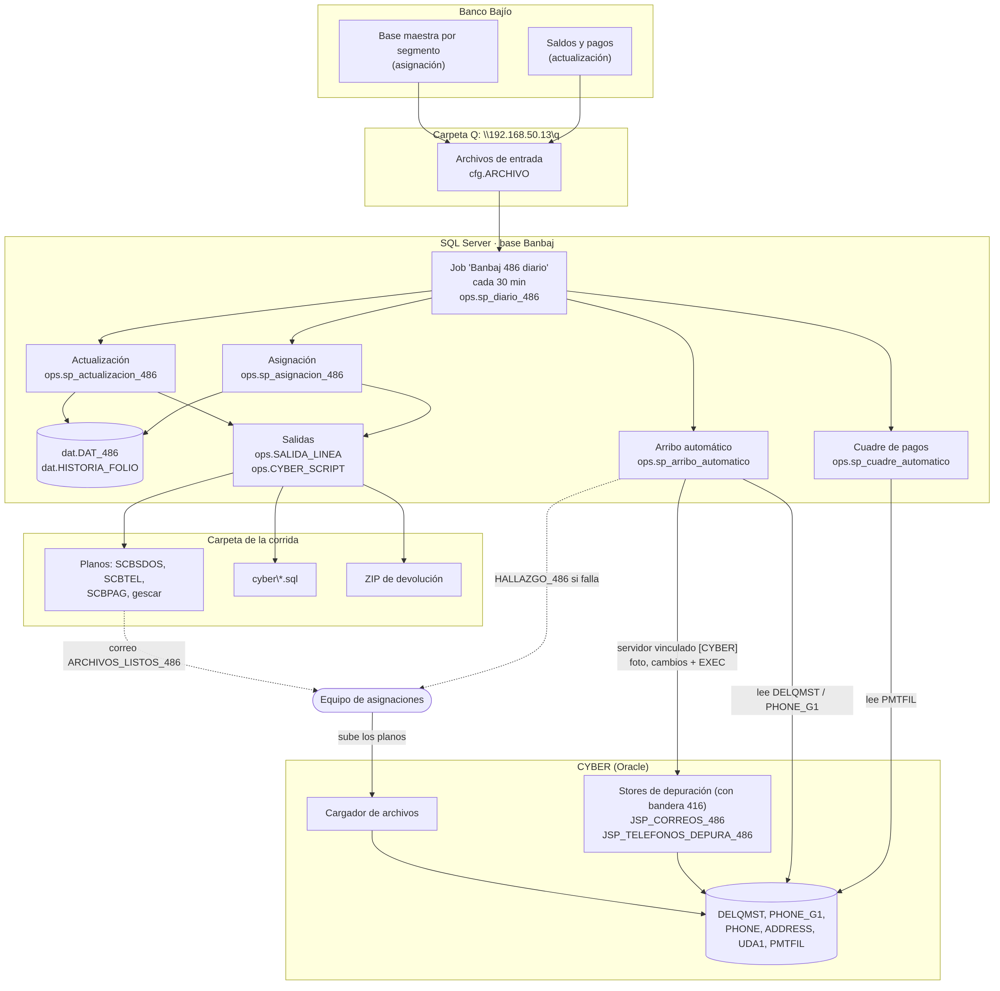

# Para qué es este manual

Banbaj es el proceso del cliente 486 (Banco Bajío) que antes corría en FoxPro y ahora vive en SQL Server (servidor `STCSVASIGNAC044\MULTISQLSERVER`, base `BNABAJ_486`). Un job lo corre solo todos los días hábiles. El equipo de asignaciones:

- **sube a CYBER los planos** cuando llega el aviso;
- **atiende los correos** que piden revisión;
- **ajusta lo configurable** (layout, etiquetas, reglas, columnas de los usuarios, destinatarios) cuando el banco cambia algo.

Este manual explica el proceso en ese orden. No hace falta saber programar: todo lo que se modifica son tablas, y para casi todo hay un comando listo. Si algo no viene aquí, el detalle técnico está en *Cómo funciona Banbaj 486*, *Flujo y diagramas Banbaj 486* y el *Manual de migración, instalación y operación*.

**Antes de ejecutar cualquier comando:**

- Conéctate a `BNABAJ_486`. Todos los bloques de este manual empiezan con `USE [BNABAJ_486];`; si se ejecutan en `master`, no encuentran nada.
- Los comandos que cambian datos tienen un modo de revisión (`@confirmar = 0` o `@solo_mostrar = 1`). Úsalo primero.
- Nunca copies cuentas, nombres, teléfonos ni correos de clientes en correos, chats o capturas. Para pedir ayuda, basta el número de corrida y el mensaje de la bitácora.

# El día en una página



| Hora aproximada | Qué pasa | Quién |
|---|---|---|
| Cada 30 min, lunes a viernes | El job revisa si llegaron archivos del banco a `\\192.168.50.13\q\CYBER\C_486\<año>\<mes>\<día>\` | Job |
| Al llegar los `.txt` de saldos y pagos | **Actualización**: valida los archivos, actualiza saldos y pagos, aplica retiros, ejecuta en CYBER los scripts de saldos y PVS, escribe el SCBPAG y actualiza las tablas de AEM y MIS | Job |
| Al llegar las bases maestras (`.csv`) y con la actualización del día OK | **Asignación**: valida, homologa, asigna folios, aplica devoluciones, escribe el SCBSDOS y avisa | Job |
| Al llegar `ARCHIVOS_LISTOS_486` | Subir a CYBER el plano que dice el correo | **Asignaciones** |
| En cuanto CYBER tiene los saldos | El job manda los gescar de nuevas, reasignadas y sin teléfono, depura teléfonos (con la bandera 416) y correos y manda el SCBTEL | Job |
| Al subir el SCBTEL | El job hace el blanqueo de status (días 1 a 10) y manda la confirmación | Job |
| Hasta las 17:00 | El job cuadra los pagos del SCBPAG contra CYBER; si falta alguno, avisa | Job |
| Día 1 de cada mes, 06:00 | Copia de CYBER las ladas válidas (PHNVAL) para filtrar los teléfonos | Job "Banbaj 486 ladas" |
| Si llega `HALLAZGO_486` o `VALIDACION_ENTRADA_486` | Revisar y resolver con lo que dice el correo | **Asignaciones** |

# Paso a paso

## 1. Actualización (todos los días hábiles)

**Entra:** `SERTEC_Saldos_tdc*.txt`, `SERTEC_Saldos_Cons*.txt` y `SERTEC_Pagos*.txt`.

1. **Validación de los archivos** (antes de tocar nada; ver la sección *Validación de la entrada*). Si un archivo no pasa, la corrida se cancela, no cambia nada y llega `VALIDACION_ENTRADA_486`. Desde el 20/11 también para si los saldos traen una cuenta repetida, si más del 30 % no está en el DAT (archivo de otro segmento) o si el archivo es idéntico al de un día anterior. Los pagos repetidos (mismo crédito, importe y fecha) solo se avisan.
2. **Respaldo** del DAT: si algo falla después, se regresa solo a como estaba.
3. **Saldos y pagos:** actualiza saldo actual, vencido, pago mínimo y PVS de cada cuenta. Los pagos negativos se excluyen y se avisan con `PAGOS_NEGATIVOS_486`.
4. **Retiros:** las cuentas que cumplen un criterio de retiro (saldo cero o negativo, etc.) se retiran solas, salvo que en un segmento pasen del 50 % de sus cuentas. En ese caso llega un hallazgo y el retiro espera la revisión del equipo.
5. **Blanqueo de ETIQUETA6 por tramo (26/11):** con el tramo nuevo de los saldos (`SEG`, la ETIQUETA3 de Operación) se quita el REE a las cuentas que ya no son elegibles: TDC fuera de `VEN2` y `VEN3` (por ejemplo `VEN4` o `CCAS`), Consumo en `CASTIGADA`. Queda en `ops.ETIQUETA6_BLANQUEO`.
6. **CYBER:** ejecuta solo los scripts de saldos, vencido, pago mínimo y PVS/REE; este último lleva también el blanqueo de ETIQUETA6 (`u1ext2`). **Ya no se sube SCBSDOS en la actualización.**
7. **SCBPAG:** se escribe en la carpeta de la corrida y llega `ARCHIVOS_LISTOS_486` para subirlo.
8. **Usuarios AEM y MIS:** se bajan de CYBER sus datos (ESTATUS y ABAN_SR) y se actualizan sus tablas.
9. **Cuadre de pagos:** en cada vuelta del job revisa que los pagos del SCBPAG ya estén en CYBER. A las 17:00 avisa los que falten.

## 2. Asignación (cuando el banco manda bases maestras)

**Entra:** `BASE MAESTRA_TARJETA*.csv`, `BASE MAESTRA_CONSUMO*.csv` y `BASE MAESTRA_HIPOTECARIO*.csv`. Solo corre si la actualización del día ya terminó OK.

**Llave única: el riesgo** (20/11). En TDC es el ACC_NUM; en Consumo e Hipotecario, el crédito. Con él se reparten los folios nuevos, se reconocen las reasignadas (el riesgo ya tuvo folio) y se decide qué se devuelve (el riesgo ya no viene en su base). La cuenta que se armaba en TDC (últimos 4 dígitos de PRIME+4DIG + RFC) sigue yendo a CYBER como cuenta del banco (DMSSNUM, SCBPAG), pero ya no identifica la cuenta.

**Un segmento a la vez** (20/11). Si llega TDC y Consumo llega más tarde, cada uno tiene su propia asignación, con sus archivos, sus avisos y su confirmación. Una base que ya se asignó ese día no se vuelve a tomar.

1. **Aviso de inicio** a Operación (`INICIO_ASIG_486`).
2. **Validación de las bases** (layout y datos). Si no pasan, la corrida se cancela y llega `VALIDACION_ENTRADA_486`. Desde el 20/11 también para si el riesgo viene repetido (en la base o entre TDC y Consumo), si trae letras o pasa de 20 dígitos, o si la base es idéntica a la de un día anterior. Avisa, sin parar, si un riesgo llega con otro RFC o cambia de segmento.
3. **Homologación:** etiqueta cada cuenta (segmento, estatus, tramo, tipo…) con los **catálogos** que mantiene el equipo. La **ETIQUETA6** vale `REE` cuando la base dice "APLICA PLAN DE PAGOS" (TDC) o "APLICA RESTRUCTURA" (Consumo); sale en U1EXT2 del SCBSDOS y sustituye a la lista TOP, que ya no se carga. Si una cuenta que ya tenía REE llega sin la leyenda, se blanquea (correo del 23/11). También se blanquea si su tramo de los saldos ya no es elegible (ver el paso 5 de la actualización).
4. **Cuentas nuevas y reasignadas:** asigna folio (`486-<folio>`) y guarda el histórico. Con más de 100 nuevas avisa a AEM (`ALERTA_NUEVAS_486`).
5. **Devoluciones:** las cuentas que ya no vienen se retiran solas, con el mismo tope de 50 % por segmento. Al cerrar el retiro sale el ZIP con el correo de devolución (Operación con el ZIP y AEM en copia oculta).
6. **Teléfonos y correos:** arma los teléfonos y los correos que se van a mandar a CYBER. Quita los de queja, los inválidos y, desde el 19/11, los que tienen una lada o longitud que el cargador no admite (`cfg.PHNVAL`, la copia de PHNVAL de CYBER que se renueva sola el día 1 de cada mes).
7. **Archivos:** escribe el SCBSDOS y avisa. El resto de los planos esperan su turno (ver el paso 3).
8. **Usuarios AEM y MIS:** actualiza sus tablas. Las cuentas nuevas traen los datos de CYBER hasta que suben los saldos.

## 3. Subir a CYBER: el orden de los avisos

El diagrama completo está en *Flujo y diagramas Banbaj 486*, sección 05.

Cada plano llega en su propio correo `ARCHIVOS_LISTOS_486`, con la carpeta, el archivo, cuántas líneas trae y qué sigue. **Sube cada archivo cuando llegue su aviso, no antes.**

| # | Llega el aviso de… | Qué subir | Qué hace el job después |
|---|---|---|---|
| 1 | **SCBSDOS** (y SCBPAG) | `SCBSDOS.TXT` con el cargador | Espera a ver los saldos en CYBER: cuentas con `DMHOSTUP` del día = cuentas del SCBSDOS |
| 2 | **Gescar de nuevas, reasignadas y sin teléfono** | `SCBACTH_486NU.TXT`, `SCBACTH_486REA.TXT` y `SCBACTH_SINTEL.TXT` | Ya con los saldos arriba, corre la depuración de teléfonos |
| 3 | **SCBTEL** | `SCBTEL.TXT` | Antes de este aviso el job ya depuró los teléfonos: comparó lo que tiene CYBER con nuestro archivo, inactivó lo que ya no viene y activó lo que sí. Después depura los correos |
| 4 | **Confirmación** (`CONFIRMACION_ASIG_486`) | Nada | Llega cuando el job ve que el SCBTEL ya subió (y hace el blanqueo). Fin del día de asignación |

**Por qué el SCBTEL va después de la depuración:** la depuración decide qué queda activo y el SCBTEL da de alta lo nuevo. Si se sube antes, la depuración no lo vería y lo contaría como algo que hay que inactivar o dar de alta otra vez.

**Depuración por diferencia** (cuando sistemas active `TEL_DEPURACION = DIFERENCIA`): el job baja de CYBER los teléfonos de las cuentas activas, los compara en SQL Server con nuestro archivo y solo le pasa a CYBER lo que cambia. El SCBTEL trae solo los teléfonos que CYBER no tenía. Si un día no hay nuevos, **no llega aviso de SCBTEL**.

**Gescar sin teléfono:** sale de nuestro archivo de teléfonos: las cuentas nuevas y reasignadas que no tienen ninguno, incluidas las que solo tenían uno de queja. Por eso llega junto con los otros gescar, sin esperar al SCBTEL.

**Lo que sigue a mano:** copiar `MX_G1MCT_DVBJIG_*` a `\\192.168.50.1\Cyber_00\dev\` si Operación lo sigue pidiendo (AEM ya toma esas cuentas de `aem.RETIROS_HOY`).

## 4. Usuarios AEM y MIS

AEM y MIS ya no reciben archivos: consultan en SQL Server, con su usuario, una tabla con las columnas que el equipo les configure.

- **AEM:** `aem.DAT_486`, con su mapeo, y `aem.RETIROS_HOY`, las cuentas retiradas hoy en la actualización y en la asignación.
- **MIS:** `mis.DAT_486`, que puede llevar columnas de las bases maestras que no están en el DAT.

Se actualizan solas en la actualización, en la asignación y cuando suben los saldos. Los datos de CYBER se leen directo de las tablas, sin ejecutar ningún store: ESTATUS de `DELQMST` y ABAN_SR de `RPT_DAT_486_1`. Cómo cambiar sus columnas: sección *Columnas de AEM y MIS*.

# Los correos y qué hacer con cada uno

| Correo | Te dice | Qué hacer |
|---|---|---|
| `ARCHIVOS_LISTOS_486` | Qué archivo subir, dónde está y qué sigue | Subirlo a CYBER. No subir nada que no se haya avisado |
| `VALIDACION_ENTRADA_486` | Un archivo del banco no pasó la revisión: falta un encabezado o hay datos raros. La corrida se canceló y **no cambió nada** | Ver *Cuando llega VALIDACION_ENTRADA_486* |
| `HALLAZGO_486` | Algo que el proceso no pudo resolver solo: retiro sobre el tope, pagos que no subieron, un paso en CYBER con error, vistas de usuarios con avisos, las ladas del mes sin actualizar… | El correo trae **qué pasó y el comando exacto para resolverlo** |
| `PAGOS_NEGATIVOS_486` | Llegaron pagos negativos; se excluyeron | Revisar con el banco si corresponde |
| `MAESTRA_NUMEROS_EXCEL_486` | La base maestra trae números cortados por Excel (notación científica). La corrida se detuvo | Pedir al banco la base sin abrirla en Excel y volver a correr |
| `INICIO_ASIG_486`, `CONFIRMACION_ASIG_486` | Inicio y fin de la asignación (para Operación) | Nada |

**Cambiar quién recibe un correo:**

```sql
USE [BNABAJ_486];
EXEC mail.sp_destinatario_alta 'ASIGNACIONES_486', 'nombre.apellido@sertec.com.mx';          -- TO
EXEC mail.sp_destinatario_alta 'ASIGNACIONES_486', 'jefe@sertec.com.mx', @tipo = 'CC';
EXEC mail.sp_destinatario_baja 'ASIGNACIONES_486', 'nombre.apellido@sertec.com.mx';
SELECT LISTA, EMAIL, TIPO FROM mail.DESTINATARIO ORDER BY LISTA, TIPO, EMAIL;                 -- quién está en cada lista
```

# Qué se puede modificar (sin tocar código)

| Si… | Se cambia en | Comando |
|---|---|---|
| El banco cambió el nombre de una columna | `cfg.ARCHIVO_COLUMNA` (layout) | `cfg.sp_layout_cambiar` |
| Llegó un estatus, tramo, cartera o tipo de crédito nuevo | `cfg.CATALOGO` (etiquetas) | `cfg.sp_catalogo_alta` |
| Una regla de datos es muy estricta o muy laxa | `cfg.VALIDACION_DATO` | `UPDATE` de `PCT_MAX`, `VALOR` o `ACTIVO` |
| AEM o MIS necesitan otra columna | `cfg.VISTA_COLUMNA` | `cfg.sp_vista_columna_alta` |
| Cambian los destinatarios de un correo | `mail.DESTINATARIO` | `mail.sp_destinatario_alta` / `_baja` |
| Hay que apagar o ajustar algo del proceso | `cfg.PARAMETRO` | `UPDATE cfg.PARAMETRO` (ver la tabla de parámetros) |

**Lo que el equipo cambia se respeta:** cuando sistemas reinstala la semilla, se conservan los cambios de layout, catálogos, reglas y columnas. Cada cambio queda registrado con quién y cuándo. Los **parámetros** sí regresan a los de fábrica en una reinstalación; sistemas los respalda y los repone (guía `ACTUALIZAR_SERVIDOR.md`).

## Layout de las bases (cuando el banco cambia una columna)

Las columnas se buscan **por encabezado, no por posición**: si el banco solo las mueve de lugar, no hay que hacer nada. Si **cambia el nombre** de una que usamos, la corrida se detiene y llega `VALIDACION_ENTRADA_486` con:

- el encabezado que no encontró;
- los encabezados nuevos del archivo (ahí suele estar el renombrado).

```sql
USE [BNABAJ_486];
SELECT * FROM cfg.v_LAYOUT WHERE ARCHIVO = 'MAESTRA_TDC';                           -- cada campo y si lo encontró en el último archivo
EXEC cfg.sp_layout_cambiar 'MAESTRA_TDC', 'SALDO2', N'MONTO A CUBRIR PLAZOS PAGO LIQUIDACION';   -- el encabezado tal como viene
EXEC cfg.sp_layout_cambiar 'MAESTRA_CONSUMO', 'PVS', N'DIAS MORA AL 13/11/2026';    -- una fecha en el encabezado se vuelve % sola
```

`cfg.sp_layout_cambiar` prueba el nombre contra el último archivo recibido y dice en qué columna lo encontró. Los archivos se llaman `MAESTRA_TDC`, `MAESTRA_CONSUMO`, `MAESTRA_HIPO`, `SALDOS_TDC`, `SALDOS_CONS` y `PAGOS`. Después, vuelve a correr el proceso (ver *Volver a correr*).

## Catálogos de etiquetas

Las etiquetas (segmento, estatus, tramo, tipo, enfoque…) salen de `cfg.CATALOGO`. Si el banco manda un valor que no está en el catálogo, la validación lo detecta y la corrida se detiene: no se etiqueta a ciegas.

| Catálogo | Valor del banco | Llena |
|---|---|---|
| `ESTATUS_TDC` | Estatus de TDC (CCAS, VEN2…) | `ESTATUS2` |
| `TRAMO_TDC` | Tramo de TDC, como número o rango (`30-59`) | `ESTATUS2` y `TIPO` |
| `ENFOQUE_TDC_90` | Enfoque de liquidación en tramo 90+ | `ESTATUS2` |
| `GARANTIA_TDC` | GARANTIZADA 1 / 0 | `GARAN` |
| `ESTATUS_CONSUMO` | VIGENTE, VENCIDA, CASTIGADA, PAGO SOSTENIDO | `SEGMENTO` |
| `CARTERA_CONSUMO` | Cartera | `TIPO` |
| `TIPO_CREDITO_CONSUMO` | Tipo de crédito | `ESTRA3` |
| `TIPO_HIPO` | Estatus de Hipotecario | `TIPO` |
| `ENFOQUE_HIPO` | Enfoque de liquidación de Hipotecario | `ETIQUETA5` |
| `ETIQUETA6_TDC` | ENFOQUE\_PLAN DE PAGOS: APLICA PLAN DE PAGOS = REE | `ETIQUETA6` (U1EXT2) |
| `ETIQUETA6_CONSUMO` | ENFOQUE\_REESTRUCTURA: APLICA RESTRUCTURA = REE | `ETIQUETA6` (U1EXT2) |
| `ETIQUETA6_SEG_TDC` | Tramo de los saldos (SEG): VEN2 y VEN3 = SI (conserva el REE); VEN4 y CCAS = NO | Blanqueo de `ETIQUETA6` |
| `ETIQUETA6_SEG_CONSUMO` | Tramo de los saldos (SEG): 1-29, 30-59, 60-89 y 90+ = SI; CASTIGADA = NO | Blanqueo de `ETIQUETA6` |
| `COSECHA_MORA` | COSECHA 1-3 | `ETIQUETA1` |

```sql
USE [BNABAJ_486];
SELECT * FROM cfg.v_CATALOGO WHERE CATALOGO = 'ESTATUS_CONSUMO' ORDER BY ORDEN, VALOR_ORIGEN;
EXEC cfg.sp_catalogo_alta 'ESTATUS_CONSUMO', N'EN REVISION', N'VEN';               -- agrega o cambia
EXEC cfg.sp_catalogo_alta 'ESTATUS_CONSUMO', N'EN REVISION', N'VEN', @activo = 0;  -- lo quita
```

- No se distinguen acentos ni mayúsculas.
- La etiqueta debe caber en el campo que llena; por ejemplo, `ESTRA3` es de 15 caracteres.
- Para quitar un valor se usa `@activo = 0`. Si se borra, la semilla lo vuelve a poner.

## Validación de la entrada

Antes de tocar el DAT, cada archivo se revisa contra las reglas de `cfg.VALIDACION_DATO`:

| Regla | Detecta |
|---|---|
| `IMPORTE` | Texto en una columna de saldo |
| `MAXIMO` | Saldo demasiado grande (casi siempre una cuenta o un teléfono que cayó en la columna de saldo) |
| `NO_NEGATIVO` | Saldos negativos en las bases maestras |
| `ENTERO` | Días de mora que no son número |
| `TELEFONO` | Teléfonos con letras o con menos de 10 o más de 12 dígitos |
| `CORREO` | Correos sin @, con espacios o sin dominio |
| `CATALOGO` | Valor que no está en el catálogo |
| `LLAVE_UNICA` | Riesgo repetido en el archivo (bases maestras y, desde el 20/11, saldos) |
| `DIGITOS` | Riesgo con letras o de más de 20 dígitos |
| `ARCHIVO_IGUAL` | El archivo es idéntico al de un día anterior (el banco reenvió el viejo) |
| `CRUCE_DAT` | Más del 30 % de los renglones de los saldos no están en el DAT (archivo de otro segmento o cliente) |
| `NO_VACIO` | Columna vacía (se corrió o cambió) |
| `VOLUMEN` | Muchos menos o muchos más renglones que la última carga buena (archivo cortado o duplicado) |

`PCT_MAX` es el porcentaje de anomalías que se tolera:

- **Si una regla lo supera,** detiene la corrida.
- **Si hay anomalías dentro de la tolerancia,** solo aparecen como aviso en la bitácora y en el correo.

```sql
USE [BNABAJ_486];
SELECT CODIGO, CAMPO, TIPO, VALOR, PCT_MAX, ACTIVO, USUARIO, FE_MOD FROM cfg.VALIDACION_DATO WHERE CLIENTE = '486' ORDER BY CODIGO, CAMPO;
UPDATE cfg.VALIDACION_DATO SET PCT_MAX = 5 WHERE CLIENTE = '486' AND CODIGO = 'MAESTRA_TDC' AND CAMPO = 'TEL1' AND TIPO = 'TELEFONO';
UPDATE cfg.VALIDACION_DATO SET VALOR = '20000000' WHERE CLIENTE = '486' AND CODIGO = 'MAESTRA_TDC' AND CAMPO = 'SDO_ACT' AND TIPO = 'MAXIMO';
SELECT * FROM ops.VALIDACION_ENTRADA WHERE ID_CORRIDA = <id>;                      -- qué encontró una corrida
```

Subir una tolerancia es una decisión del equipo: si el archivo viene mal, lo correcto es pedirlo corregido al banco.

## Columnas de AEM y MIS

Cada columna es un renglón de `cfg.VISTA_COLUMNA`, con el encabezado exacto que verá el usuario y su origen:

| Origen | Qué es el campo | Ejemplo |
|---|---|---|
| `DAT` | Una columna del DAT | `CUENTA` ← `CUENTA2`, `ETIQUETA03` ← `TIPO` |
| `CYBER` | Uno de los campos de CYBER disponibles (`SELECT * FROM cfg.CYBER_CAMPO;`: ESTATUS, ABAN_SR, ABAN_CR, SDO_CYBER). Uno nuevo lo agrega sistemas | `ESTATUS_CYBER` ← `ESTATUS`, `ABANDONO_SR` ← `ABAN_SR` |
| `MAESTRA` | Un encabezado de la base maestra, tal como lo manda el banco | Cualquier columna de las bases de TDC, Consumo o Hipotecario |
| `CONSTANTE` | Un valor fijo | `GRUPO` ← `1` |

```sql
USE [BNABAJ_486];
SELECT VISTA, ORDEN, ENCABEZADO, ORIGEN, CAMPO, ACTIVO FROM cfg.VISTA_COLUMNA WHERE CLIENTE = '486' ORDER BY VISTA, ORDEN;
EXEC cfg.sp_vista_columna_alta 'MIS', N'LIMITE_CREDITO', 'MAESTRA', N'LIMITE DE CREDITO';     -- agrega o cambia
EXEC cfg.sp_vista_columna_alta 'AEM', N'ETIQUETA05', 'DAT', N'ETIQUETA5', @orden = 175;       -- en una posición
EXEC cfg.sp_vista_columna_alta 'AEM', N'ETIQUETA05', 'DAT', N'ETIQUETA5', @activo = 0;        -- quitarla
UPDATE cfg.VISTA_USUARIO SET ACTIVO = 1 WHERE CLIENTE = '486' AND VISTA = 'MIS';               -- activar un usuario
EXEC ops.sp_vistas_usuario_armar;                                                                -- aplicarlo ya, sin esperar al siguiente proceso
```

- `cfg.sp_vista_columna_alta` revisa que el campo exista en el DAT y avisa si la base maestra no trae ese encabezado.
- **Si un campo no existe,** la tabla se arma sin esa columna (o vacía) y llega un hallazgo.
- Los textos van recortados, sin espacios de relleno.
- Las cuentas que se crean con una asignación no traen datos de CYBER hasta que se suben los saldos.
- Los usuarios con su contraseña los crea sistemas.

## Parámetros

Se ven y se cambian en `cfg.PARAMETRO`. Cambia solo los de esta tabla; los demás (rutas, CYBER, correo) son de sistemas.

| Parámetro | De fábrica | Para qué |
|---|---|---|
| `RETIRO_TOPE_PCT_ASIG` / `RETIRO_TOPE_PCT_ACT` | 50 | % de las cuentas de un segmento arriba del cual el retiro no se aplica solo |
| `ALERTA_NUEVAS` | 100 | Más cuentas nuevas que esto manda `ALERTA_NUEVAS_486` |
| `CUADRE_PAGOS_HORA_LIMITE` | 17:00 | Hora a la que el cuadre deja de esperar el SCBPAG y avisa |
| `DIAS_BLANQUEO_STATUS` | 1-10 | Días del mes en que se blanquea el status |
| `ARRIBO_SDOS_MIN_PCT` | 100 | % de cuentas del SCBSDOS con `DMHOSTUP` del día para dar por subidos los saldos |
| `ARRIBO_MIN_PCT` | 95 | % de lo pendiente que debe estar en CYBER (por ejemplo, teléfonos nuevos) para dar por subido el SCBTEL |
| `VALIDAR_LAYOUT` / `VALIDAR_DATOS` | 1 | 0 apaga la revisión de encabezados o de datos (solo en una emergencia) |
| `TEL_VALIDAR_LADA` | 1 | 0 deja pasar teléfonos con ladas que el cargador no admite (solo en una emergencia) |
| `TEL_DEPURA_MAX_INACTIVAR_PCT` | 30 | Con la depuración por diferencia, si se inactivaría más de este % de los teléfonos activos, no se toca CYBER y llega un hallazgo |
| `TEL_GESTORES_QUEJA` | HOMS,HPHPI,BLACK,ZZZTE | Gestores de queja: la depuración por diferencia no toca sus teléfonos |
| `RETIRO_AUTOMATICO`, `ARRIBO_AUTOMATICO`, `ACT_CYBER_AUTOMATICO`, `BLANQUEO_AUTOMATICO`, `CONFIRMACION_AUTOMATICA`, `CUADRE_AUTOMATICO`, `EXPORTAR_AUTOMATICO`, `AVISO_ARCHIVOS`, `VISTAS_USUARIO` | 1 | 0 apaga esa parte automática y queda a mano |

```sql
USE [BNABAJ_486];
SELECT CLAVE, VALOR, DESCRIPCION FROM cfg.PARAMETRO WHERE CLIENTE = '486' ORDER BY CLAVE;
UPDATE cfg.PARAMETRO SET VALOR = '40' WHERE CLIENTE = '486' AND CLAVE = 'RETIRO_TOPE_PCT_ASIG';
```

Avisa a sistemas de cada parámetro que cambies, para que se reponga si se reinstala.

## Lo que no se modifica aquí

- **Las fórmulas de homologación** (`cfg.HOMOLOGACION`): el tramo 90+, el saldo PRIME cuando el saldo actual viene vacío, la estructura REE. Las tablas de equivalencias sí son catálogos; la lógica es código.
- **Los planos de CYBER** (`cfg.SALIDA`, anchos fijos): un cambio rompe el cargador.
- **Los stores de CYBER**: los instala el DBA.
- Las tablas `dat.*` y `ops.*` directamente: siempre con los procesos y comandos de este manual.

Para cualquiera de estos, pide el cambio a sistemas. Se hace en el repositorio, con su prueba, y se instala con la guía.

# Revisar y volver a correr

## Cómo va el día

```sql
USE [BNABAJ_486];
SELECT TOP 5 ID_CORRIDA, PROCESO, FECHA_PROCESO, ESTATUS, MENSAJE FROM ops.CORRIDA WHERE CLIENTE = '486' ORDER BY ID_CORRIDA DESC;
SELECT PASO, ESTATUS, REGISTROS, MENSAJE FROM ops.BITACORA WHERE ID_CORRIDA = <id> ORDER BY ID;   -- cada paso, con OK / AVISO / ERROR
EXEC ops.sp_arribo_automatico;                                                                      -- en qué va el arribo: ESPERANDO SALDOS, ESPERANDO SCBTEL…
```

Si llegaron dos segmentos en momentos distintos, ese día hay dos asignaciones: `EXEC ops.sp_arribo_automatico;` muestra en qué va cada una.

| Estatus de la corrida | Significa |
|---|---|
| `OK` | Terminó bien |
| `CANCELADA` | Se detuvo a propósito (validación de la entrada, devolución masiva). **El DAT no cambió** |
| `ERROR` | Falló. **El DAT regresó solo** a como estaba |
| `REVERTIDA` | Alguien la deshizo a mano |

## Cuando llega VALIDACION_ENTRADA_486

1. Lee el correo: dice qué encabezado faltó, qué encabezados nuevos traía el archivo y qué anomalías encontró, con ejemplos enmascarados.
2. Corrige lo que corresponda:
   - **encabezado renombrado:** `cfg.sp_layout_cambiar`;
   - **valor nuevo:** `cfg.sp_catalogo_alta`;
   - **regla muy estricta:** `cfg.VALIDACION_DATO`;
   - **archivo mal:** pídelo de nuevo al banco y déjalo en la carpeta del día.
3. Vuelve a correr el proceso.

## Volver a correr un proceso

```sql
USE [BNABAJ_486];
EXEC ops.sp_actualizacion_486 @fecha = 'AAAA-MM-DD';
EXEC ops.sp_asignacion_486 @fecha = 'AAAA-MM-DD';       -- solo si la actualización del día ya está OK
```

El job no repite solo un proceso que quedó `CANCELADA` o `ERROR`: hay que correrlo a mano después de corregir.

## Pasos que quedaron en ERROR

El correo de hallazgo trae el comando. Los más comunes:

| Paso en ERROR | Comando |
|---|---|
| Ladas del mes sin actualizar (hallazgo "Ladas válidas (PHNVAL) sin actualizar") | `EXEC ops.sp_phnval_actualizar;` e historial con `SELECT TOP (5) * FROM cfg.PHNVAL_CARGA ORDER BY ID DESC;` |
| `ARRIBO TELEFONOS` (no cuadró lo que subió, falló el store o se apagó la bandera por error) | `EXEC ops.sp_arribar_cyber <id>, 'TELEFONOS';` (con `@solo_mostrar = 1` solo muestra). Si la bandera 416 quedara encendida: `SELECT * FROM ops.CYBER_SCRIPT WHERE ID_CORRIDA = <id> AND SCRIPT = 'TEL_INACTIVA_BANDERA';` y ejecutarlo en CYBER |
| `TEL DIFERENCIA` (se iba a inactivar más del tope) | Revisar nuestro archivo de teléfonos de la corrida (`SELECT COUNT(*) FROM ops.TELEFONO WHERE ID_CORRIDA = <id>;`) y el mensaje del hallazgo. Si es correcto, subir `TEL_DEPURA_MAX_INACTIVAR_PCT` solo para esa vez y correr `EXEC ops.sp_arribar_cyber <id>, 'TELEFONOS';` |
| `ARRIBO CORREOS` | `EXEC ops.sp_arribar_cyber <id>, 'CORREOS';` |
| `GESCAR SIN TELEFONO` | `EXEC ops.sp_arribo_gescar_sintel <id>;` (lo vuelve a generar de nuestros teléfonos, lo escribe y avisa) |
| `ACT CYBER` | `EXEC ops.sp_act_cyber <id>;` (solo repite lo pendiente) |
| `RETIRO …` | `EXEC ops.sp_retiro_cerrar <id>, @solo_mostrar = 1;` y luego sin `@solo_mostrar` |
| Retiro detenido por el tope | Revisar con `SELECT * FROM ops.DEVOLUCION WHERE ID_CORRIDA = <id> AND PROCESADA = 0;` y, si es correcto, `EXEC ops.sp_retiro <id>;` seguido de `EXEC ops.sp_retiro_cerrar <id>;` |
| `VISTAS USUARIO` | `EXEC ops.sp_vistas_usuario_refrescar <id>, @forzar = 1;` |
| Ya se subió todo y el arribo no lo detecta | `EXEC ops.sp_marcar_arribo <id>, 'FIN';` |
| Volver a mandar el aviso de archivos | `EXEC ops.sp_aviso_archivos <id>;` |

## Deshacer una corrida

```sql
USE [BNABAJ_486];
EXEC ops.sp_revertir_corrida <id>;                    -- muestra qué cambiaría
EXEC ops.sp_revertir_corrida <id>, @confirmar = 1;    -- la deshace
```

Revertir regresa el DAT, el histórico, los folios y la base maestra a como estaban antes de esa corrida. Solo se puede revertir la última. **Lo que ya se subió a CYBER no se deshace**: avisa a sistemas antes de revertir una corrida cuyos archivos ya estén arriba.

## Pruebas de entorno

Para probar en el servidor sin tocar CYBER ni mandar correos reales (antes de producción, o después de un cambio grande), corre en orden los scripts de `pruebas_entorno/` (su `LEEME.md` explica cada uno): modo prueba, bajada de CYBER, correos, detección y lectura de archivos, asignación de prueba, reversión y apagar el modo prueba. Todo lo que muestran son conteos; nunca datos de clientes.

**Siempre termina con `08_modo_prueba_apagar.sql`.** Mientras el modo de prueba está encendido, los correos solo llegan a quien hizo la prueba y nada se escribe en CYBER.

Ya en producción, sistemas puede borrar lo de las pruebas y lo de la migración con `sql/instalacion/06_limpiar_pruebas.sql` y `05_limpiar_migracion.sql`.

## Rutas de entrada y salida

| Qué | Ruta | Parámetro o dónde se cambia |
|---|---|---|
| **Entrada.** Bases maestras y archivos de actualización del banco | `\\192.168.50.13\q\CYBER\C_486\<año>\<mes>\<día>\` (= `Q:\CYBER\C_486\2026\noviembre\26\`). Mes en español y minúsculas, día con dos dígitos. Asignación: `BASE MAESTRA_TARJETA*.csv`, `BASE MAESTRA_CONSUMO*.csv`, `BASE MAESTRA_HIPOTECARIO*.csv`. Actualización: `SERTEC_Saldos_tdc*.txt`, `SERTEC_Saldos_Cons*.txt`, `SERTEC_Saldos_Hip*.txt` (apagado), `SERTEC_Pagos*.txt` | `cfg.ARCHIVO.RUTA` y `PATRON_NOMBRE` |
| **Entrada.** Tablas de CYBER (DELQMST, PHONE, PHONE_G1, ADDRESS, UDA1, RPT_DAT_486_1, PHNVAL, remesas, bitácora de banderas) | Servidor vinculado `[CYBER]` (Oracle), no es carpeta | `CYBER_LINKED_SERVER`, `cfg.sp_cyber_conectar` |
| **Entrada.** CSV de la migración desde FoxPro (una sola vez) | `C:\MIGRA486\<FUENTE>.csv` en el servidor de SQL Server | `@carpeta` de `ops.sp_migrar_486` |
| **Entrada.** CSV de exclusiones y etiquetas (cargas a mano) | La que indiques, visible para el servicio de SQL Server (ej. `C:\BANBAJ\486\CARGAS\`) | `@archivo` de `cfg.sp_exclusion_cargar` y `cfg.sp_etiqueta_cargar` |
| **Salida.** Archivos planos de cada corrida | `C:\BANBAJ\486\SALIDA\<aaaammdd>_corrida<id>\` (ej. `C:\BANBAJ\486\SALIDA\20261126_corrida125\`) | `RUTA_SALIDA` |
| **Salida.** Scripts de Oracle de esa corrida (ACT_SALDOS, ACT_PVS_REE, retiro, depuraciones) | `C:\BANBAJ\486\SALIDA\<aaaammdd>_corrida<id>\cyber\` | `RUTA_SALIDA` |
| **Salida.** Copia del DAT para MIS | `\\192.168.50.13\q\MIS\SERTEC98\CLIENTES\486\DAT486_<aaaammdd>.csv` | `RUTA_MIS` |
| **Salida.** ZIP de retiros con contraseña | `C:\RETIROS_PAG_486_<mmddaaaahhmmss>.zip` | `CARPETA_ZIP` (contraseña: credencial `ZIP_RETIROS`) |
| **Salida.** Devolución para CYBER (`MX_G1MCT_DVBJIG_<aaaammdd>_<hhmmss>`) | Se escribe en la carpeta de la corrida; se copia a `\\192.168.50.1\Cyber_00\dev\` (a mano mientras el parámetro esté vacío) | `RUTA_DEVOLUCION_CYBER` |
| Programa para el ZIP | `C:\Program Files\7-Zip\7z.exe` | `RUTA_7ZIP` |
| Carpeta de las pruebas de entorno | `C:\BANBAJ\486\PRUEBA\` (se borra al terminar) | `@carpeta` de `ops.sp_prueba_modo` |
| Respaldo de la base antes de actualizar | `C:\BANBAJ\respaldo_BNABAJ_486_<aaaammdd>.bak` | Comando `BACKUP` del paso 0 |

Archivos que deja cada proceso en la carpeta de su corrida:

| Proceso | Archivos |
|---|---|
| Asignación | `SCBSDOS.TXT`, `SCBTEL.TXT`, `sub_mst.TXT`, `sub_mail.TXT`, `SCBACTH_486NU.TXT`, `SCBACTH_486REA.TXT`, `SCBACTH_SINTEL.TXT` (al subir los saldos), `DAT486_<aaaammdd>.csv` |
| Actualización | `SCBPAG.TXT`, `DAT486_<aaaammdd>.csv` y en `cyber\` los scripts `ACT_SALDOS`, `ACT_VENCIDO`, `ACT_PAGMIN` y `ACT_PVS_REE` (este último lleva también el blanqueo de ETIQUETA6) |
| Retiro | `SCBACTH_486.TXT`, `RETIROS_486_<aaaammdd>.csv`, `MX_G1MCT_DVBJIG_<aaaammdd>_<hhmmss>`, `DAT486_<aaaammdd>.csv` y el ZIP en `CARPETA_ZIP` |
| Etiquetado | `SCBSDOS.TXT`, `DAT486_<aaaammdd>.csv` |
| Blanqueo de status | `BLANQUEA_486_<aaaammdd>.csv` |

Para ver las rutas que tiene el servidor:

```sql
USE [BNABAJ_486];
SELECT CODIGO, PROCESO, RUTA, PATRON_NOMBRE, ACTIVO FROM cfg.ARCHIVO WHERE CLIENTE = '486' ORDER BY PROCESO, ORDEN;
SELECT CLAVE, VALOR FROM cfg.PARAMETRO WHERE CLIENTE = '486'
  AND CLAVE IN ('RUTA_SALIDA', 'RUTA_MIS', 'CARPETA_ZIP', 'RUTA_DEVOLUCION_CYBER', 'RUTA_7ZIP', 'CYBER_LINKED_SERVER');
```

## Procesos a mano

| Necesidad | Comando |
|---|---|
| Retiro por solicitud del banco | `EXEC ops.sp_retiro_solicitud @archivo = N'…\cuentas.csv';` (revisa) y luego con `@confirmar = 1` |
| Cambiar una etiqueta a varias cuentas | `EXEC ops.sp_etiquetar_campo @campo = 'ETIQUETA1', @archivo = N'…\etiquetas.csv';` (CSV con FOLIO,ETIQUETA) y luego con `@confirmar = 1` |
| SCBSDOS fuera de proceso | `EXEC ops.sp_regenerar_scbsdos @motivo = N'…';` |
| Lista negra o exclusiones | `EXEC cfg.sp_exclusion_cargar @tipo = 'TELEFONO', @archivo = N'…', @req = '…', @solicita = N'…';` |

# Glosario

| Término | Qué es |
|---|---|
| **DAT** | `dat.DAT_486`: la cartera vigente del 486, una fila por cuenta |
| **Corrida** | Una ejecución de un proceso (actualización, asignación, retiro, etiquetado), con su número `ID_CORRIDA` |
| **Bitácora** | `ops.BITACORA`: un renglón por paso de cada corrida, con OK, AVISO o ERROR |
| **Folio / CUENTA2** | La cuenta en CYBER: `486-<folio>` |
| **SCBSDOS** | Plano de saldos que crea o actualiza las cuentas en CYBER |
| **SCBTEL** | Plano de teléfonos |
| **Gescar** | Planos de gestión (`SCBACTH_*`): nuevas, reasignadas, sin teléfono y retiro |
| **SCBPAG** | Plano de pagos |
| **Remesa** | La lista completa de teléfonos o correos que se manda a una tabla de CYBER para depurar (con la depuración por diferencia, en teléfonos solo van los cambios) |
| **Bandera 416** | Registro en `RPT_LOG_CYBER_REG` que dice que el 486 se está actualizando en CYBER; se enciende durante la depuración de teléfonos y la de correos |
| **Depuración** | Store de CYBER que inactiva lo que no está en la remesa y activa lo que sí |
| **DMHOSTUP** | Fecha de la última subida de saldos de una cuenta en CYBER; así detecta el job que el SCBSDOS ya subió |
| **Hallazgo** | Correo `HALLAZGO_486`: algo que el proceso no resolvió solo, con qué hacer |
| **Semilla** | Script que deja la configuración de fábrica sin borrar lo que cambió el equipo |
