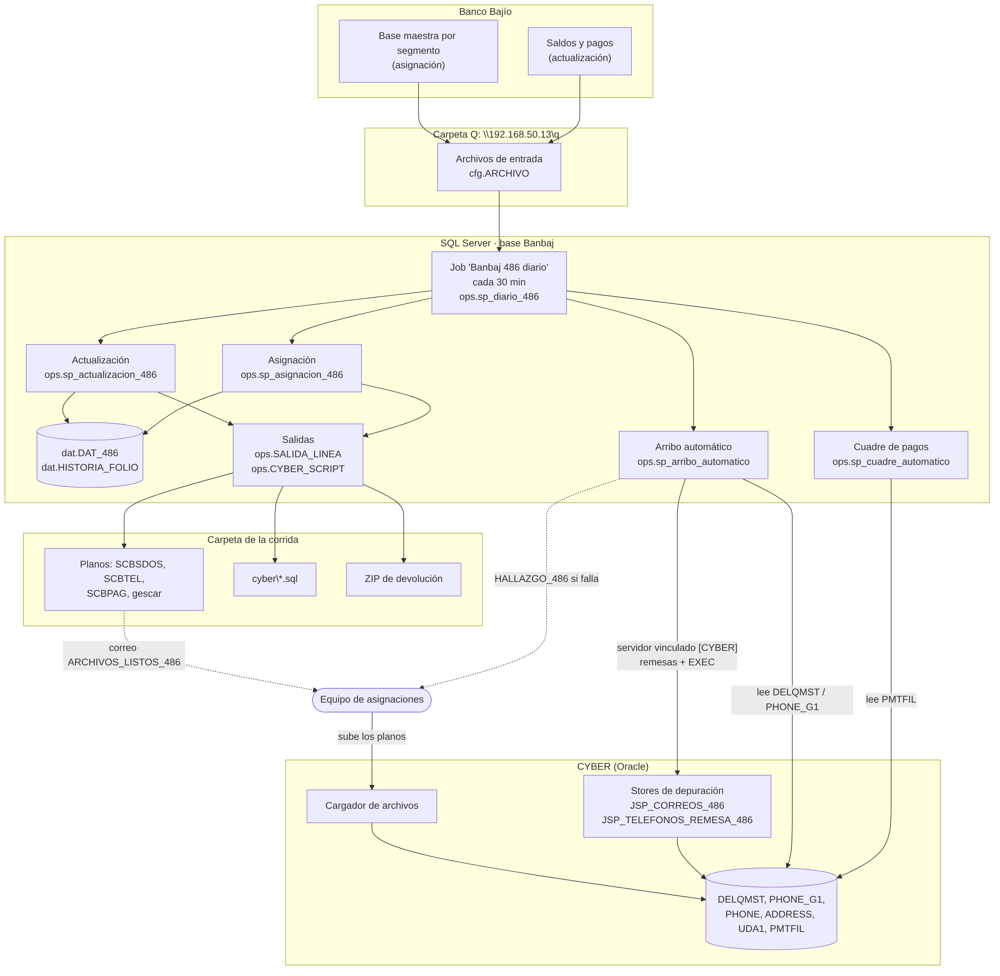

# 01 · Vista general

Fuente: [`mmd/01_vista_general.mmd`](mmd/01_vista_general.mmd)

**Entrada.** El banco deja en `\\192.168.50.13\q` (Q:) las bases maestras por segmento (asignación) y los archivos de saldos y pagos (actualización). Las rutas y nombres están en `cfg.ARCHIVO` y se leen con `BULK INSERT` (`ops.sp_cargar_proceso`).

**SQL Server.** El job *Banbaj 486 diario* (`sql/instalacion/02_crear_job_486.sql`) corre `ops.sp_diario_486` cada 30 minutos en días hábiles. Ese procedimiento decide qué toca (diagrama 02): actualización, asignación, arribo automático y cuadre. El DAT (`dat.DAT_486`) y el histórico de folios (`dat.HISTORIA_FOLIO`) son el estado del cliente.

**Salidas.** Cada corrida deja los planos en `ops.SALIDA_LINEA` y los scripts de Oracle en `ops.CYBER_SCRIPT`. `ops.sp_exportar_auto` los escribe en `RUTA_SALIDA\<aaaammdd>_corrida<N>\`, junto con el ZIP de devolución si hubo retiro, y avisa al equipo de asignaciones con `ARCHIVOS_LISTOS_486`.

**CYBER.** Asignaciones sube los planos de ancho fijo con el cargador de CYBER (lo único que sigue a mano, junto con la copia de la devolución a `Cyber_00`). Lo demás lo hace SQL Server por el servidor vinculado `[CYBER]` (OraOLEDB):

- Lee `DELQMST` y `PHONE_G1` para saber si ya se subieron los planos.
- Carga las remesas y ejecuta los stores de depuración `JSP_CORREOS_486` y `JSP_TELEFONOS_REMESA_486`.
- Ejecuta los scripts `ACT_*`, `RETIRO` y `BLANQUEO_STATUS`.
- Lee `PMTFIL` para el cuadre de pagos.

**Para cambiar algo:** ubica la parte en el diagrama correspondiente (02 a 08). La conexión a CYBER está en `sql/74_sp_cyber.sql` (`cfg.sp_cyber_conectar`, parámetros `CYBER_LINKED_SERVER`, `CYBER_ORACLE_ORIGEN`, `CYBER_ORACLE_PROVEEDOR` y credencial `CYBER_ORACLE`).
