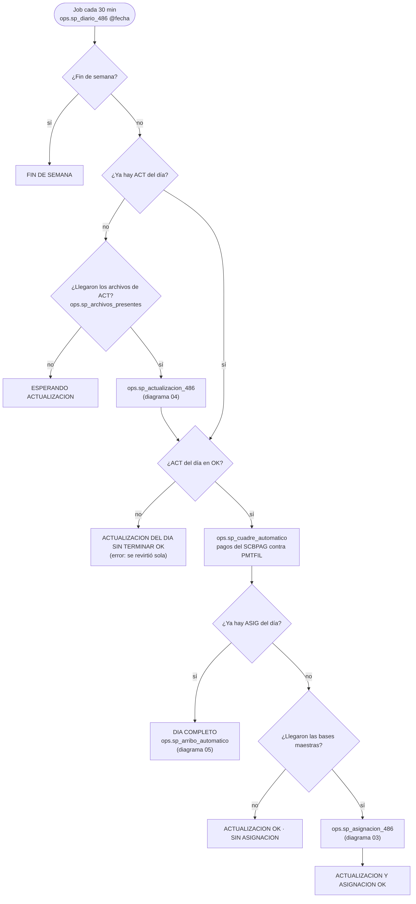

# 02 · Flujo diario (lo que decide el job)

Fuente: [`mmd/02_flujo_diario.mmd`](mmd/02_flujo_diario.mmd) · Código: `ops.sp_diario_486` en `sql/60_sp_orquestadores.sql`

En cada vuelta (cada 30 minutos), el job revisa en orden y contesta con un `RESULTADO`:

| Revisión | Si no se cumple | Si se cumple |
|---|---|---|
| ¿Fin de semana? (`cfg.fn_es_fin_de_semana`) | sigue | `FIN DE SEMANA` (se puede forzar con `@forzar = 1`) |
| ¿Ya hay actualización del día? | si llegaron sus archivos (`ops.sp_archivos_presentes 'ACT'`) corre `ops.sp_actualizacion_486`; si no, `ESPERANDO ACTUALIZACION` | sigue |
| ¿La actualización del día quedó OK? | `ACTUALIZACION DEL DIA SIN TERMINAR OK` (se revirtió sola; ver la bitácora) | corre `ops.sp_cuadre_automatico` y sigue |
| ¿Ya hay asignación del día? | si llegaron las bases maestras corre `ops.sp_asignacion_486`; si no, `ACTUALIZACION OK · SIN ASIGNACION (POR AHORA)` | `DIA COMPLETO` y corre `ops.sp_arribo_automatico` |

Una corrida que falla no se repite sola en la misma fecha: queda `ERROR` en `ops.CORRIDA`, el DAT se restaura (`ops.sp_retroceso_automatico`) y se vuelve a correr a mano con `EXEC ops.sp_diario_486 @fecha = '…'` una vez corregida la causa (o revirtiendo la corrida con `ops.sp_revertir_corrida`).

**Parámetros:** `ASIG_REQUIERE_ACT` (la asignación espera a la actualización del día). Los demás están en cada diagrama.

**Para cambiar el orden o agregar un paso diario:** se edita `ops.sp_diario_486`. Cada llamada a un paso automático va en su propio `TRY/CATCH` para que un error no detenga lo demás. Prueba: la sección *diario* de `tests/pruebas.sql` (`EXEC ops.sp_diario_486 '2026-11-07'` = fin de semana).
