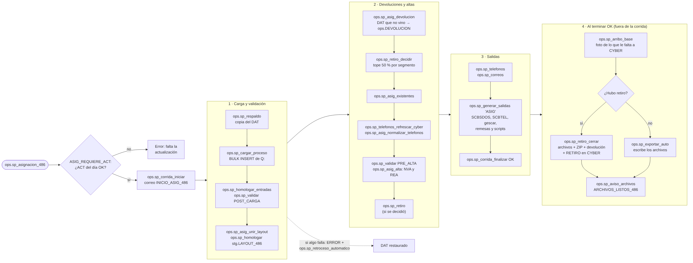

# 03 · Asignación

Fuente: [`mmd/03_asignacion.mmd`](mmd/03_asignacion.mmd) · Código: `ops.sp_asignacion_486` en `sql/60_sp_orquestadores.sql`

**Dentro de la corrida** (si cualquier paso falla, la corrida queda en ERROR y `ops.sp_retroceso_automatico` restaura el DAT):

| Paso | Procedimiento (archivo) | Qué hace |
|---|---|---|
| Respaldo | `ops.sp_respaldo` (35) | Copia el DAT antes de tocarlo |
| Carga | `ops.sp_cargar_proceso` (20) | Lee las bases maestras de Q: (`cfg.ARCHIVO`, proceso ASIG) |
| Homologar y validar | `ops.sp_homologar_entradas` (60), `ops.sp_validar 'POST_CARGA'` (20) | Formatos, números cortados por Excel (`MAESTRA_NUMEROS_EXCEL_486`), saldos ≤ 0 en Consumo |
| Unir layout | `ops.sp_asig_unir_layout`, `ops.sp_homologar 'stg.LAYOUT_486'` (30, 20) | Junta los segmentos en `stg.LAYOUT_486` |
| Devoluciones | `ops.sp_asig_devolucion` (30) | Cuentas del DAT que no vienen en la base maestra → `ops.DEVOLUCION`. `TOPE_DEVOLUCION_PCT` cancela la asignación si son demasiadas |
| Decidir retiro | `ops.sp_retiro_decidir` (77) | Tope de 50 % por segmento (diagrama 06) |
| Existentes | `ops.sp_asig_existentes` (30) | Actualiza las que siguen; sus teléfonos se quedan como llegan |
| Teléfonos | `ops.sp_telefonos_refrescar_cyber`, `ops.sp_asig_normalizar_telefonos` (45) | Quejas y plan de numeración de CYBER; normaliza los de nuevas y reasignadas |
| Alta | `ops.sp_validar 'PRE_ALTA'`, `ops.sp_asig_alta` (30) | NVA y REA con folio nuevo (`dat.FOLIO_CONSECUTIVO`) |
| Retiro | `ops.sp_retiro` (30) | Solo si se decidió aplicarlo |
| Teléfonos y correos | `ops.sp_telefonos` (45), `ops.sp_correos` (46) | Arman lo que se manda a CYBER (`ops.TELEFONO`, `ops.CORREO`) |
| Salidas | `ops.sp_generar_salidas 'ASIG'` (50) | SCBSDOS, SCBTEL, sub_mst, sub_mail, gescar NVA y REA, scripts de remesas |

**Al terminar OK** (fuera de la corrida; si falla queda en la bitácora y llega un hallazgo):

1. `ops.sp_arribo_base`: foto de lo que le falta a CYBER (diagrama 05). Se toma antes de escribir los archivos, así el operador todavía no pudo subir nada.
2. Si hubo retiro, `ops.sp_retiro_cerrar` (archivos, ZIP, correo de devolución y RETIRO en CYBER). Si no, `ops.sp_exportar_auto` (archivos).
3. `ops.sp_aviso_archivos`: correo `ARCHIVOS_LISTOS_486` a asignaciones.

**Parámetros:** `ASIG_REQUIERE_ACT`, `TOPE_DEVOLUCION_PCT`, `RETIRO_AUTOMATICO`, `RETIRO_TOPE_PCT_ASIG`, `ARRIBO_AUTOMATICO`, `EXPORTAR_AUTOMATICO`, `AVISO_ARCHIVOS`, `ALERTA_NUEVAS`.

**Para cambiar:** un paso nuevo dentro de la corrida va entre los `EXEC` del `TRY` (si toca el DAT, el retroceso lo cubre). Un paso que escriba fuera de SQL Server (CYBER, disco, correo) va después del `CATCH`, en su propio `TRY/CATCH`. Pruebas: el escenario de asignación de `tests/pruebas.sql` (corridas 1 y 2 sobre los datos de `tests/generar_datos_prueba.py`).
