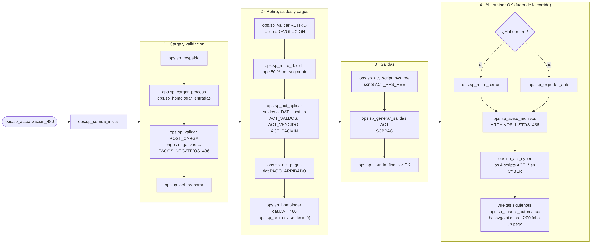

# 04 · Actualización

Fuente: [`mmd/04_actualizacion.mmd`](mmd/04_actualizacion.mmd) · Código: `ops.sp_actualizacion_486` en `sql/60_sp_orquestadores.sql`, pasos en `sql/40_sp_actualizacion.sql`

**Dentro de la corrida:**

| Paso | Procedimiento | Qué hace |
|---|---|---|
| Respaldo y carga | `ops.sp_respaldo`, `ops.sp_cargar_proceso`, `ops.sp_homologar_entradas` | Saldos y pagos del banco |
| Validar | `ops.sp_validar 'POST_CARGA'` | Pagos negativos: se excluyen y sale `PAGOS_NEGATIVOS_486`; pagos a T-1 quedan en la bitácora |
| Preparar | `ops.sp_act_preparar` | Junta saldos con el DAT |
| Reglas de retiro | `ops.sp_validar 'RETIRO'` y `ops.sp_retiro_decidir` | Cuentas a devolver → `ops.DEVOLUCION`; tope de 50 % por segmento |
| Aplicar | `ops.sp_act_aplicar` | Saldos al DAT y scripts `ACT_SALDOS`, `ACT_VENCIDO`, `ACT_PAGMIN` |
| Pagos | `ops.sp_act_pagos` | `dat.PAGO_ARRIBADO` (lo que sube en el SCBPAG) |
| Homologar | `ops.sp_homologar 'dat.DAT_486'` | REE por segmento, tramo y tipo |
| Retiro | `ops.sp_retiro` | Solo si se decidió aplicarlo |
| PVS/REE | `ops.sp_act_script_pvs_ree` | Script `ACT_PVS_REE` (sustituye al SCBSDOS de la actualización) |
| Salidas | `ops.sp_generar_salidas 'ACT'` | SCBPAG |

**Al terminar OK:**

1. Si hubo retiro, `ops.sp_retiro_cerrar`; si no, `ops.sp_exportar_auto`. Las dos avisan con `ARCHIVOS_LISTOS_486` (subir el SCBPAG).
2. `ops.sp_act_cyber` (`sql/78_sp_automatico.sql`): ejecuta en CYBER los cuatro scripts `ACT_*` y deja un paso `ACT CYBER <script>` por cada uno. Si uno falla, los demás siguen, llega un hallazgo y se repite con `EXEC ops.sp_act_cyber <id>;` (solo lo pendiente).
3. En las vueltas siguientes del job, `ops.sp_cuadre_automatico` baja los pagos del día de `PMTFIL` y los empareja (cuenta + importe, uno a uno) con `dat.PAGO_ARRIBADO`. Si todo subió termina sin correo. Si a `CUADRE_PAGOS_HORA_LIMITE` (17:00) falta alguno, deja el cuadre en `ops.RECHAZO` (`CUADRE_PAGOS`) y manda un hallazgo con la lista.

**Parámetros:** `RETIRO_AUTOMATICO`, `RETIRO_TOPE_PCT_ACT`, `EXPORTAR_AUTOMATICO`, `ACT_CYBER_AUTOMATICO`, `CUADRE_AUTOMATICO`, `CUADRE_PAGOS_HORA_LIMITE`.

**Para cambiar:** los scripts de CYBER se arman en `ops.sp_act_aplicar` y `ops.sp_act_script_pvs_ree` (texto en `ops.CYBER_SCRIPT`); su ejecución, en `ops.sp_act_cyber`. Pruebas: `ACT CYBER: …` y `CUADRE AUTO: …` en `tests/pruebas.sql`.
