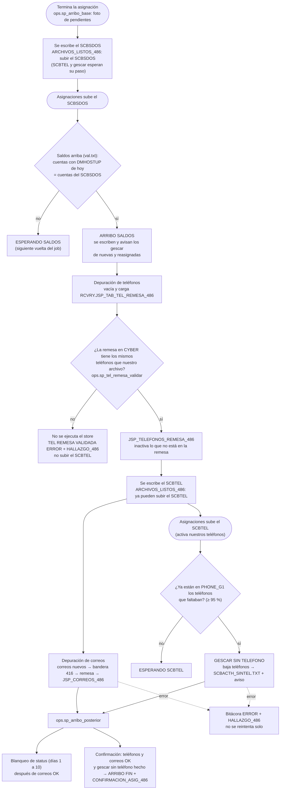

# 05 · Arribo a CYBER (depuraciones de correos y teléfonos)

Fuente: [`mmd/05_arribo_cyber.mmd`](mmd/05_arribo_cyber.mmd) · Código: `sql/76_sp_arribo_cyber.sql`, `ops.sp_arribo_posterior` y `ops.sp_aviso_archivos` en `sql/78_sp_automatico.sql`, `ops.fn_archivos_diferidos` en `sql/10_funciones.sql`

**Orden (decisión 17/11).** Lo marcan los stores de CYBER: `JSP_TELEFONOS_REMESA_486` inactiva todo lo que no está en la remesa y el SCBTEL activa nuestros teléfonos, así que primero va la depuración de teléfonos y después se sube el SCBTEL. El equipo confirmó (17/11) que al subir el SCBTEL los teléfonos quedan activos en `PHONE`, también los nuevos que el store no insertó porque aún no estaban en `PHONE_G1`. Los planos los sube una persona, y el job se da cuenta solo de cuándo ya están.

**SCBTEL solo con los nuevos (decisión 18/11, `TEL_DEPURACION = NUEVOS`).** Se sigue subiendo a CYBER la remesa completa, porque así Oracle compara en el momento: inactiva todo lo activo que no tenemos, **incluido lo que un gestor agregó hace un momento**. Después, el store nuestro `RCVRY.JSP_TELEFONOS_DEPURA_486` (`cyber/486/oracle/`) marca `NUEVO` lo que no existe en `PHONE`. Banbaj baja esos nuevos (`ops.sp_tel_nuevos`) y el SCBTEL lleva **solo esos**: el cargador lo acepta sin inactivar lo demás y los da de alta activos.
- **Si no hay nuevos,** no sale SCBTEL y el gescar sin teléfono sale enseguida.
- **Si hay nuevos,** el gescar sin teléfono espera a que estén en `PHONE_G1`.
- Ya no se inserta en `PHONE` desde `PHONE_G1`.

Mientras el DBA no instale el store, `TEL_DEPURACION = ACTUAL` deja todo como el 17/11: `JSP_TELEFONOS_REMESA_486` y el SCBTEL con todos los teléfonos.

| # | Paso del job | Cuándo | Bitácora |
|---|---|---|---|
| 0 | Al terminar la asignación se escribe el SCBSDOS y se avisa (`ARCHIVOS_LISTOS_486`). El SCBTEL y los gescar todavía no (`ops.fn_archivos_diferidos`) | Corrida OK | `EXPORTAR AUTOMATICO` |
| 1 | Se marcan los saldos arriba y se escriben y avisan los gescar de nuevas y reasignadas | Cuentas con `DMHOSTUP` del día = cuentas del SCBSDOS | `ARRIBO SALDOS` |
| 2 | **Depuración de teléfonos:** vacía y carga `RCVRY.JSP_TAB_TEL_REMESA_486`; si tiene los mismos renglones que nuestro archivo de teléfonos (`ops.TELEFONO`, lo que va en `sub_mst.TXT`), ejecuta `JSP_TELEFONOS_REMESA_486`. Con `NUEVOS` ejecuta `JSP_TELEFONOS_DEPURA_486`, baja los nuevos y el SCBTEL queda solo con ellos. Luego escribe el SCBTEL y avisa que ya se puede subir (si no hay nuevos, no sale) | Saldos arriba | `TEL REMESA VALIDADA`, `TEL NUEVOS`, `ARRIBO TELEFONOS` |
| 3 | **Depuración de correos:** correos nuevos en `ADDRESS`, bandera 416, remesa y `JSP_CORREOS_486` | Depuración de teléfonos OK | `ARRIBO CORREOS` |
| 4 | **Gescar sin teléfono:** baja los teléfonos activos y escribe `SCBACTH_SINTEL.TXT` con su aviso (`ops.sp_arribo_gescar_sintel`) | Teléfonos OK y el SCBTEL ya subió (≥ `ARRIBO_MIN_PCT` de los teléfonos pendientes ya están en `PHONE_G1`; con `NUEVOS`, los pendientes son los nuevos, y sin nuevos no hay que esperar) | `GESCAR SIN TELEFONO` |

**Foto de pendientes** (`ops.sp_arribo_base`, al terminar la asignación). Compara lo que se manda con lo que CYBER ya tiene y guarda en `ops.ARRIBO_PENDIENTE` lo que falta:

| Tipo | Qué falta |
|---|---|
| CUENTA | Cuentas del SCBSDOS que no están activas en `DELQMST` (nuevas y reasignadas) |
| DOMICILIO | Cuentas activas cuyo `DMADDR1` en CYBER es distinto al del SCBSDOS (`CYBER_COLUMNA_DOMICILIO`) |
| TELEFONO | Teléfonos del SCBTEL, de todas las cuentas, que no están en `PHONE_G1`. Con `NUEVOS`, al depurar se cambian por los teléfonos nuevos |

**Detección** (`ops.sp_arribo_automatico`, en cada vuelta con el día completo). Baja de CYBER el estado actual (`ops.sp_arribo_bajar` → `stg.CYBER_HOSTUP`, `stg.CYBER_DELQMST_ACT`, `stg.CYBER_PHONE_G1`):

- **Saldos arriba:** la validación del equipo (`val.txt`): `select dmhostup, count(*) from rcvry.delqmst where dmacctg='1' and dmcompany='486' and dmstatus is null group by dmhostup`. Si las cuentas con `DMHOSTUP` del día son tantas como las del SCBSDOS (`ARRIBO_SDOS_MIN_PCT`, 100 = que coincidan), ya subieron. Con `CYBER_HOSTUP_EXPR` vacío se usa lo pendiente: al menos `ARRIBO_MIN_PCT` (95 %) de las cuentas y los domicilios.
- **SCBTEL arriba:** al menos 95 % de los teléfonos pendientes ya están en `PHONE_G1`. Solo cuenta después de la depuración de teléfonos.
- El resultado dice en qué va: `ESPERANDO SALDOS`, `DEPURACION DE TELEFONOS CON ERROR`, `ESPERANDO SCBTEL` o lo que hizo en esa vuelta. `EXEC ops.sp_marcar_arribo <id>, 'FIN';` da todo por subido.

**Guardas:** sin remesa no se ejecuta ningún store (inactivaría todo el 486), ni dentro de una transacción. Si la remesa de teléfonos no cuadra (error 50776), no se ejecuta `JSP_TELEFONOS_REMESA_486`, no sale el SCBTEL y los correos esperan. Si falla con la bandera 416 encendida, intenta apagarla.

**Después** (`ops.sp_arribo_posterior`):

- Con correos OK, el blanqueo de status (`ops.sp_blanqueo_automatico`, días `DIAS_BLANQUEO_STATUS`).
- Con teléfonos y correos OK, el gescar sin teléfono ya intentado (el SCBTEL subió) y el blanqueo intentado, `ops.sp_confirmar_asignacion` marca `ARRIBO FIN` y manda `CONFIRMACION_ASIG_486`.

**Errores:** quedan `ARRIBO TELEFONOS`, `ARRIBO CORREOS` o `GESCAR SIN TELEFONO` en ERROR con el mensaje (de Oracle, o las dos cifras si la remesa no cuadró) y llega un hallazgo. No se reintenta solo; se corrige y se corre `EXEC ops.sp_arribar_cyber <id>, 'TELEFONOS';` (o `'CORREOS'`, con `@solo_mostrar = 1` se ven los bloques sin ejecutar) o `EXEC ops.sp_arribo_gescar_sintel <id>;`.

**Parámetros:** `ARRIBO_AUTOMATICO`, `ARCHIVOS_DESPUES_SALDOS` (gescar NVA y REA), `ARCHIVOS_DESPUES_DEPURACION_TEL` (SCBTEL), `CYBER_HOSTUP_EXPR`, `ARRIBO_SDOS_MIN_PCT`, `ARRIBO_MIN_PCT`, `CYBER_COLUMNA_DOMICILIO`, `CYBER_REMESA_TEL_COLUMNAS`, `CYBER_REMESA_MAIL_COLUMNAS`, `CYBER_SENTENCIAS_POR_BLOQUE`, `CYBER_VALIDADOR_TELEFONOS`, `TEL_DEPURACION`, `CYBER_PROC_TEL_DEPURA`, `CYBER_PROC_TELEFONOS`, `BLANQUEO_AUTOMATICO`, `CONFIRMACION_AUTOMATICA`.

**Para cambiar:** la regla de detección está en `ops.sp_arribo_automatico` (variables `@listo_s`, `@listo_g`, `@tel_ok` y los pasos 1 a 4); lo que se manda a CYBER, en los scripts que arma la asignación (`sql/45_sp_telefonos.sql`, `sql/46_sp_correos_cyber.sql`) y en `ops.sp_arribar_cyber`. Los stores de Oracle están en `cyber/486/oracle/`. Pruebas: `ARRIBO BASE: …`, `ARRIBO AUTO …`, `ARRIBO TEL: …`, `ARRIBO: …` y `CONFIRMACION AUTO: …` en `tests/pruebas.sql`.
