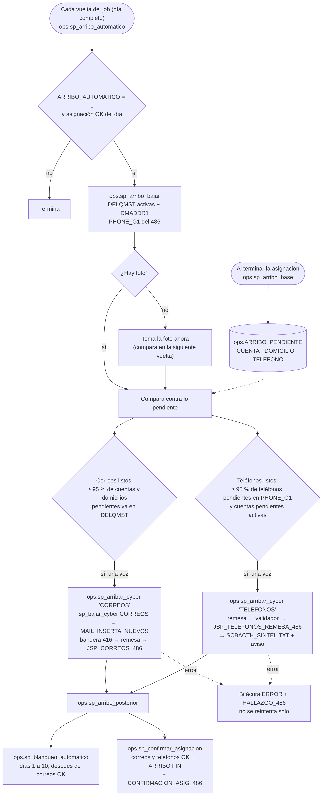

# 05 · Arribo a CYBER (depuraciones de correos y teléfonos)

Fuente: [`mmd/05_arribo_cyber.mmd`](mmd/05_arribo_cyber.mmd) · Código: `sql/76_sp_arribo_cyber.sql` y `ops.sp_arribo_posterior` en `sql/78_sp_automatico.sql`

**El problema que resuelve.** Los stores de CYBER necesitan que el SCBSDOS y el SCBTEL ya estén cargados: el de correos solo trabaja cuentas activas en `DELQMST`, y el de teléfonos inserta desde `PHONE_G1`. Esos archivos los sube una persona, así que el job tiene que darse cuenta solo de cuándo ya están.

**Foto de pendientes** (`ops.sp_arribo_base`, al terminar la asignación). Compara lo que se manda con lo que CYBER ya tiene y guarda en `ops.ARRIBO_PENDIENTE` lo que falta:

| Tipo | Qué falta |
|---|---|
| CUENTA | Cuentas del SCBSDOS que no están activas en `DELQMST` (nuevas y reasignadas) |
| DOMICILIO | Cuentas activas cuyo `DMADDR1` en CYBER es distinto al del SCBSDOS (`CYBER_COLUMNA_DOMICILIO`) |
| TELEFONO | Teléfonos del SCBTEL, de todas las cuentas, que no están en `PHONE_G1` |

Se compara contra lo pendiente y no contra las altas, para que funcione aunque un día no haya cuentas nuevas.

**Detección** (`ops.sp_arribo_automatico`, en cada vuelta con el día completo). Baja de CYBER el estado actual (`ops.sp_arribo_bajar` → `stg.CYBER_DELQMST_ACT`, `stg.CYBER_PHONE_G1`) y calcula:

- **Correos listos:** ya llegó al menos `ARRIBO_MIN_PCT` (95 %) de las cuentas y los domicilios pendientes.
- **Teléfonos listos:** ya llegó al menos 95 % de los teléfonos pendientes y las cuentas pendientes ya están activas.
- Si no había nada pendiente, se arriba en la siguiente vuelta. `EXEC ops.sp_marcar_arribo <id>, 'FIN';` da todo por subido.

**Depuración** (`ops.sp_arribar_cyber`), una vez por corrida cada una:

- **CORREOS:** `ops.sp_bajar_cyber 'CORREOS'` (correos nuevos), remesa `JSP_TAB_MAIL_REMESA_486`, scripts `MAIL_INSERTA_NUEVOS`, `MAIL_ACTIVA_BANDERA` (416), `MAIL_BORRA`, `MAIL_REMESA`, `MAIL_ACTUALIZA` (llama a `JSP_CORREOS_486`) y `MAIL_INACTIVA_BANDERA`.
- **TELEFONOS:** remesa `JSP_TAB_TEL_REMESA_486`, scripts `TEL_BORRA` (con el renglón de `JSP_VALIDADOR_TELEFONOS`), `TEL_REMESA` y `TEL_ACTUALIZA` (llama a `JSP_TELEFONOS_REMESA_486`). Después baja los teléfonos y escribe `SCBACTH_SINTEL.TXT`, con su propio aviso.
- Guardas: no corre si la remesa sale vacía (inactivaría todo el 486) ni dentro de una transacción. Si falla con la bandera 416 encendida, intenta apagarla.

**Después** (`ops.sp_arribo_posterior`):

- Con correos OK, el blanqueo de status (`ops.sp_blanqueo_automatico`, días `DIAS_BLANQUEO_STATUS`).
- Con correos y teléfonos OK (y el blanqueo intentado), `ops.sp_confirmar_asignacion` marca `ARRIBO FIN` y manda `CONFIRMACION_ASIG_486`.

**Errores:** quedan `ARRIBO CORREOS` / `ARRIBO TELEFONOS` en ERROR con el mensaje de Oracle y llega un hallazgo. No se reintenta solo; se corrige y se corre `EXEC ops.sp_arribar_cyber <id>, 'CORREOS';` (con `@solo_mostrar = 1` se ven los bloques PL/SQL sin ejecutar).

**Parámetros:** `ARRIBO_AUTOMATICO`, `ARRIBO_MIN_PCT`, `CYBER_COLUMNA_DOMICILIO`, `CYBER_REMESA_TEL_COLUMNAS`, `CYBER_REMESA_MAIL_COLUMNAS`, `CYBER_SENTENCIAS_POR_BLOQUE`, `CYBER_VALIDADOR_TELEFONOS`, `BLANQUEO_AUTOMATICO`, `CONFIRMACION_AUTOMATICA`.

**Para cambiar:** la regla de detección está en `ops.sp_arribo_automatico` (variables `@ok_c`, `@ok_d`, `@ok_t`, `@listo_c`, `@listo_t`); lo que se manda a CYBER, en los scripts que arma la asignación (`sql/45_sp_telefonos.sql`, `sql/46_sp_correos_cyber.sql`) y en `ops.sp_arribar_cyber`. Los stores de Oracle están en `cyber/486/oracle/`. Pruebas: `ARRIBO BASE: …`, `ARRIBO AUTO: …` y `CONFIRMACION AUTO: …` en `tests/pruebas.sql`.
