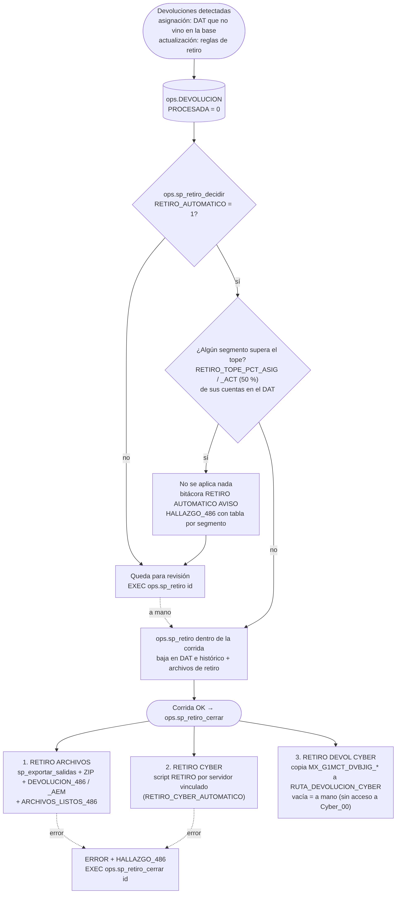

# 06 · Retiro (devoluciones)

Fuente: [`mmd/06_retiro.mmd`](mmd/06_retiro.mmd) · Código: `sql/77_sp_retiro_automatico.sql`, `ops.sp_retiro` en `sql/30_sp_asignacion.sql`, `ops.sp_retiro_solicitud` en `sql/32_sp_retiro_solicitud.sql`

**De dónde salen las devoluciones** (`ops.DEVOLUCION`, con `PROCESADA = 0`):

- Asignación: cuentas del DAT que no vienen en la base maestra del día (`ops.sp_asig_devolucion`).
- Actualización: reglas de retiro (`ops.sp_validar 'RETIRO'`).
- Retiro por solicitud del banco: lista en CSV con `ops.sp_retiro_solicitud` (se confirma con `@confirmar = 1`).

**Decidir** (`ops.sp_retiro_decidir`, con el DAT todavía como estaba). Por segmento compara las cuentas a devolver contra las que ese segmento tiene en el DAT:

- Si ninguno supera el tope (`RETIRO_TOPE_PCT_ASIG` y `RETIRO_TOPE_PCT_ACT`, 50 %), se aplica `ops.sp_retiro` dentro de la corrida (baja en el DAT y el histórico, y archivos de retiro).
- Si alguno lo supera, no se aplica nada: queda `RETIRO AUTOMATICO` en AVISO y sale un hallazgo con la tabla por segmento. Si el retiro es correcto: `EXEC ops.sp_retiro <id>; EXEC ops.sp_retiro_cerrar <id>;`.

**Cerrar** (`ops.sp_retiro_cerrar`, con la corrida ya en OK). Tres pasos, cada uno una sola vez:

| Paso | Qué hace | Control |
|---|---|---|
| RETIRO ARCHIVOS | Escribe los archivos, arma el ZIP con contraseña, manda `DEVOLUCION_486` (Operación, con ZIP) y `DEVOLUCION_486_AEM` (sin ZIP), y `ARCHIVOS_LISTOS_486` | siempre |
| RETIRO CYBER | Ejecuta el script `RETIRO` (`dmstatus = 'R'`) por el servidor vinculado | `RETIRO_CYBER_AUTOMATICO` (o `@con_cyber = 1`) |
| RETIRO DEVOL CYBER | Copia `MX_G1MCT_DVBJIG_*` a `RUTA_DEVOLUCION_CYBER` | Vacía = a mano: hoy el servidor no tiene acceso a `\\192.168.50.1\Cyber_00\dev\` |

Si un paso falla, sale un hallazgo y se repite con `EXEC ops.sp_retiro_cerrar <id>;` (`@solo_mostrar = 1` enseña cuáles faltan). Lo que ya se escribió en CYBER no se revierte con el retroceso.

**Parámetros:** `RETIRO_AUTOMATICO`, `RETIRO_TOPE_PCT_ASIG`, `RETIRO_TOPE_PCT_ACT`, `RETIRO_CYBER_AUTOMATICO`, `RUTA_DEVOLUCION_CYBER`, `TOPE_DEVOLUCION_PCT` (cancela la asignación completa).

**Para cambiar:** el tope está en `ops.sp_retiro_decidir`, y los pasos del cierre en `ops.sp_retiro_cerrar`. Pruebas: `RETIRO AUTO: …` y `RETIRO CERRAR: …` en `tests/pruebas.sql`.
