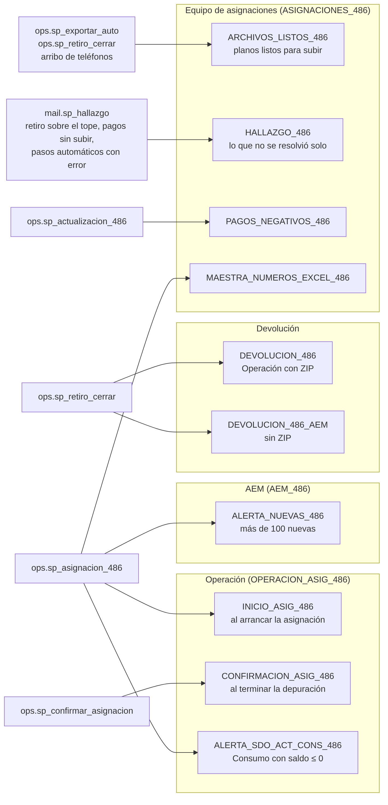

# 07 · Correos

Fuente: [`mmd/07_correos.mmd`](mmd/07_correos.mmd) · Código: `mail.sp_enviar` y `mail.sp_hallazgo` en `sql/25_sp_correo.sql`; plantillas y listas en `PLANTILLAS` y `LISTAS` de `tools/generar_sql_486.py`

| Plantilla | Lista | Cuándo | Quién lo manda |
|---|---|---|---|
| `INICIO_ASIG_486` | `OPERACION_ASIG_486` | Al arrancar la asignación | `ops.sp_asignacion_486` |
| `CONFIRMACION_ASIG_486` | `OPERACION_ASIG_486` | Al terminar OK la depuración de correos y teléfonos | `ops.sp_confirmar_asignacion` |
| `ALERTA_NUEVAS_486` | `AEM_486` | Más de `ALERTA_NUEVAS` cuentas nuevas | asignación |
| `ALERTA_SDO_ACT_CONS_486` | `OPERACION_ASIG_486` | Consumo con saldo actual ≤ 0 | validaciones |
| `DEVOLUCION_486` / `_AEM` | `DEVOLUCION_OPERACION_486` / AEM en copia oculta | Al cerrar un retiro (con ZIP para Operación, sin ZIP para AEM) | `ops.sp_retiro_cerrar` → `ops.sp_exportar_salidas` |
| `ARCHIVOS_LISTOS_486` | `ASIGNACIONES_486` | En cuanto se escriben los planos que se suben a CYBER (`ARCHIVOS_ARRIBO`) | `ops.sp_aviso_archivos` |
| `HALLAZGO_486` | `ASIGNACIONES_486` | Lo que el proceso no resolvió solo: retiro sobre el tope, pagos que no subieron, cualquier paso automático con error | `mail.sp_hallazgo` |
| `PAGOS_NEGATIVOS_486` | `ASIGNACIONES_486` | Llegan pagos negativos | actualización |
| `MAESTRA_NUMEROS_EXCEL_486` | `ASIGNACIONES_486` | Base maestra con números cortados por Excel (se detiene) | asignación |

Cada envío queda en `mail.ENVIO`. `ARCHIVOS_LISTOS_486` y `HALLAZGO_486` no repiten el mismo contenido en la misma corrida (lo revisan en la bitácora, pasos `AVISO ARCHIVOS` y `HALLAZGO`).

**Para cambiar destinatarios:** `EXEC mail.sp_destinatario_alta` / `mail.sp_destinatario_baja` (no hay que tocar código). **Para un correo nuevo:** se agrega la plantilla en `tools/generar_sql_486.py`, se regenera la semilla y se manda con `mail.sp_enviar @plantilla, @id_corrida, @valores` (JSON; las llaves `HTML_*` van sin escapar, armadas con `mail.fn_tabla_html`). Para avisar algo al equipo de asignaciones basta `EXEC mail.sp_hallazgo @id, N'Título', N'Qué pasó', N'Qué hacer', @tabla_json;`. Pruebas: `HALLAZGO: …` y `AVISO ARCHIVOS: …` en `tests/pruebas.sql`.
