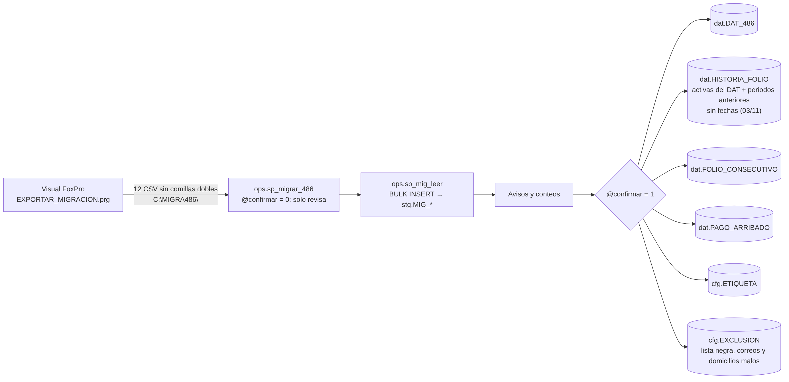

# 08 · Migración (una sola vez)

Fuente: [`mmd/08_migracion.mmd`](mmd/08_migracion.mmd) · Código: `cyber/486/EXPORTAR_MIGRACION.prg` y `ops.sp_migrar_486` en `sql/80_sp_migracion.sql` · Paso a paso: `docs/MIGRACION_PASO_A_PASO_486.md`

1. **FoxPro** exporta 12 DBF a `C:\MIGRA486\` solo con los campos que se usan. Antes de escribir cada CSV cambia las comillas dobles por sencillas y los saltos de línea por espacios, porque FoxPro no los escapa y SQL Server rechaza el archivo.
2. **`ops.sp_migrar_486 @carpeta`** lee cada CSV con `ops.sp_mig_leer` (`BULK INSERT FORMAT = 'CSV'` a `stg.MIG_<fuente>`, todas las columnas texto) y regresa archivos leídos, destinos y avisos, sin escribir.
3. **Con `@confirmar = 1`** carga todo en una transacción: DAT; histórico (activas del DAT y periodos anteriores de historia.dbf, con NVA/REA por orden de FE_ASIG y los datos en `DATOS_BAJA`; sus fechas de asignación, reasignación y retiro quedan vacías desde el 03/11); consecutivo de folios; pagos; etiquetas y exclusiones. `@reemplazar = 1` sobrescribe; `@solo` carga una parte.

PURGA, DEVOL, TELBAJ, PNC y LADA no se migran.

**Para cambiar:** una columna nueva se agrega en `laF[n, 3]` del `.prg` (guárdalo en cp1252 con CRLF) y se mapea en el bloque de su fuente en `ops.sp_migrar_486`. Pruebas: `tests/prueba_migracion.sql`.
