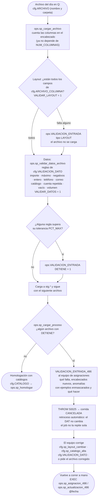

# 09 · Validación de la entrada, layout y catálogos



Fuente: [`mmd/09_validacion_entrada.mmd`](mmd/09_validacion_entrada.mmd) · Código: `ops.sp_cargar_archivo` y `ops.sp_cargar_proceso` en `sql/20_sp_comunes.sql`, `sql/22_sp_validacion_entrada.sql`, `cfg.fn_catalogo` en `sql/10_funciones.sql`

Desde el 17/11 la actualización y la asignación revisan cada archivo **antes de tocar el DAT**. Si algo no cuadra, la corrida se detiene, se avisa al equipo de asignaciones y el equipo la vuelve a correr a mano cuando lo corrige.

## Layout: qué columnas toma el proceso

El layout de cada archivo vive en dos tablas que el equipo puede editar:

| Tabla | Qué guarda |
|---|---|
| `cfg.ARCHIVO` | Nombre del archivo (`PATRON_NOMBRE`), carpeta (`RUTA`), si está activo |
| `cfg.ARCHIVO_COLUMNA` | Por cada campo (`CAMPO_DESTINO`), el encabezado que se busca (`PATRON_ENCABEZADO`, patrón LIKE: `%` = cualquier texto, como la fecha) |

- Las columnas se buscan **por encabezado, no por posición**: si el banco las cambia de lugar no hay que hacer nada.
- El número de columnas se cuenta en el renglón de encabezados. `NUM_COLUMNAS` ya solo sirve de referencia: si no coincide, queda un AVISO en la bitácora.
- Con `VALIDAR_LAYOUT = 1`, si falta **cualquier** campo que toma el proceso (obligatorio u opcional), ese archivo no se carga y la corrida se detiene al terminar de revisar todos los archivos.
- Si un encabezado coincide con varias columnas, se toma la primera y queda un aviso.

**Cambiar el layout** (cuando el banco renombra una columna):

```sql
USE [BNABAJ_486];
EXEC cfg.sp_layout_cambiar 'MAESTRA_TDC', 'SALDO2', N'MONTO A CUBRIR PLAZOS PAGO LIQUIDACION';   -- el encabezado tal como viene
EXEC cfg.sp_layout_cambiar 'MAESTRA_CONSUMO', 'PVS', N'DIAS MORA AL 13/11/2026';                 -- la fecha se vuelve % sola
SELECT * FROM cfg.v_LAYOUT WHERE ARCHIVO = 'MAESTRA_TDC';                                         -- ESTADO por campo contra el último archivo
```

`cfg.sp_layout_cambiar` prueba el patrón contra los encabezados del último archivo recibido y dice en qué columna lo encontró. También se puede hacer un `UPDATE` directo a `cfg.ARCHIVO_COLUMNA`. Cada cambio queda en `cfg.LAYOUT_HISTORIAL` y marca el renglón (`EDITADO_POR`, `FE_EDICION`), y **la semilla lo conserva** al reinstalar. Para regresar un campo al valor de fábrica: `EDITADO_POR = NULL` y correr `90_semilla_486.sql`.

## Datos: que la columna traiga lo que debe

Reglas en `cfg.VALIDACION_DATO` (una por archivo, campo y tipo), revisadas sobre el texto tal como llegó:

| TIPO | Detecta | Tolerancia de fábrica |
|---|---|---|
| `IMPORTE` | Texto que no es importe en una columna de saldo ("abc", "N/A") | 0 % |
| `MAXIMO` | Importe mayor que `VALOR` (10 millones en TDC y Consumo, 50 en Hipotecario): casi siempre una cuenta o un teléfono que cayó en la columna de saldo | 0 % |
| `NO_NEGATIVO` | Saldos negativos en las bases maestras | 1 % |
| `ENTERO` | Días de mora que no son número | 0 % |
| `TELEFONO` | Teléfono con letras o con menos de 10 o más de 12 dígitos (`0` y `-` cuentan como vacío) | 2 % |
| `CORREO` | Correo sin forma de correo: sin @, con espacios o sin dominio ("solo texto") | 2 % |
| `CATALOGO` | Segmento, estatus, tramo, cartera o tipo de crédito que **no está en el catálogo** | 0 % |
| `LLAVE_UNICA` | Cuenta repetida en el archivo. 20/11: también en los saldos (ACC_NUM en TDC, crédito CYBER en Consumo) | 0 % |
| `DIGITOS` | La llave única (ACC_NUM en TDC, crédito en Consumo) con letras o de más de 20 dígitos (20/11) | 0 % |
| `ARCHIVO_IGUAL` | El archivo es idéntico al último archivo bueno de otro día: el banco reenvió el anterior (20/11; bases maestras y saldos) | 0 % |
| `CRUCE_DAT` | Renglones de los saldos cuya llave no está en el DAT (`VALOR` = columna del DAT): archivo de otro segmento o de otro cliente (20/11) | 30 % |
| `NO_VACIO` | La columna viene vacía: se corrió o cambió | 1 a 5 % |
| `VOLUMEN` | El archivo trae menos del 30 % o más del 300 % de los renglones de la última carga buena (archivo cortado o duplicado) | rango en `VALOR` |

- Las tolerancias se calibraron con las bases reales del 11 y 13/11: teléfonos de 10 dígitos sin letras, menos de 0.2 % de correos mal formados, saldos de hasta 1.2 millones y sin cuentas repetidas.
- `PCT_MAX` es el % de anomalías tolerado sobre los valores revisados. Si una regla lo supera, detiene; si tiene anomalías dentro de la tolerancia, solo aparece como aviso en la bitácora y en el correo.
- En la actualización un saldo negativo o cero no se valida aquí: es criterio de retiro (`cfg.REGLA RETIRO_*`). Los pagos negativos se siguen excluyendo y avisando (`PAGOS_NEGATIVOS_486`).
- El equipo ajusta `VALOR`, `PCT_MAX` y `ACTIVO`; la semilla solo agrega las reglas que falten.
- **Riesgo repetido entre segmentos (20/11):** si el mismo riesgo llega en la base de TDC y en la de Consumo de la misma asignación, `ops.sp_asig_unir_layout` detiene la corrida y avisa igual (`VALIDACION_ENTRADA_486`, archivo `LAYOUT_486`). Repetido dentro de una base lo decide `LLAVE_UNICA`.
- **Avisos que no detienen (20/11):** mismo riesgo con otro RFC que el del DAT y cuentas que cambian de segmento (`ops.sp_asig_avisos_llave`); pagos repetidos en el archivo (mismo crédito, importe y fecha). Llegan en el correo de hallazgos con los valores enmascarados.
- `PRIME4DIG` ya no es llave (20/11): su regla de repetidos queda apagada.

## Catálogos estáticos de etiquetado

Lo que antes estaba escrito en la homologación ahora es la tabla `cfg.CATALOGO`: el equipo cambia o agrega un valor y la siguiente corrida lo usa. `cfg.fn_catalogo` compara sin acentos ni mayúsculas; el valor exacto gana sobre los patrones (`%`, `[0-9]`) y entre patrones gana el `ORDEN` menor.

| Catálogo | Valor del banco | Llena |
|---|---|---|
| `ESTATUS_TDC` | Estatus de TDC (CCAS, VEN2…; BCOB, BOPE, FALL = REE con tramo 0) | `ESTATUS2` |
| `TRAMO_TDC` | Tramo de TDC, como número o rango (`30-59`) | `ESTATUS2` y `TIPO` |
| `ENFOQUE_TDC_90` | Enfoque de liquidación en tramo 90+ | `ESTATUS2` |
| `GARANTIA_TDC` | GARANTIZADA 1 / 0 | `GARAN` |
| `ESTATUS_CONSUMO` | VIGENTE, VENCIDA, CASTIGADA, PAGO SOSTENIDO | `SEGMENTO` |
| `CARTERA_CONSUMO` | Cartera | `TIPO` |
| `TIPO_CREDITO_CONSUMO` | Tipo de crédito | `ESTRA3` |
| `TIPO_HIPO` | Estatus de Hipotecario | `TIPO` |
| `ENFOQUE_HIPO` | Enfoque de liquidación de Hipotecario | `ETIQUETA5` |
| `ETIQUETA6_TDC` | ENFOQUE\_PLAN DE PAGOS: APLICA PLAN DE PAGOS = REE | `ETIQUETA6` (U1EXT2) |
| `ETIQUETA6_CONSUMO` | ENFOQUE\_REESTRUCTURA: APLICA RESTRUCTURA = REE | `ETIQUETA6` (U1EXT2) |
| `COSECHA_MORA` | COSECHA 1-3 | `ETIQUETA1` (MORA 1-3) |

```sql
USE [BNABAJ_486];
SELECT * FROM cfg.v_CATALOGO ORDER BY CATALOGO, ORDEN, VALOR_ORIGEN;            -- VALIDA = 1: un valor fuera del catálogo detiene
EXEC cfg.sp_catalogo_alta 'ESTATUS_CONSUMO', N'EN REVISION', N'VEN';           -- agrega o cambia
EXEC cfg.sp_catalogo_alta 'ESTATUS_CONSUMO', N'EN REVISION', N'VEN', @activo = 0;   -- lo quita
```

Para quitar un valor se usa `ACTIVO = 0`: si se borra, la semilla lo vuelve a poner. La etiqueta debe caber en el campo que llena (por ejemplo, `ESTRA3` es de 15 caracteres).

La lógica que no es una tabla de equivalencias sigue en `cfg.HOMOLOGACION`: el tramo 90+ que depende del enfoque, el saldo actual vacío o ≤ 0 que toma el saldo PRIME y la estructura REE de la actualización (`estructura.prg`).

## Qué pasa cuando no pasa

1. `ops.sp_cargar_proceso` revisa todos los archivos y junta lo encontrado en `ops.VALIDACION_ENTRADA`.
2. `ops.sp_validacion_entrada_avisar` manda `VALIDACION_ENTRADA_486` al equipo de asignaciones (lista `ASIGNACIONES_486`). El correo trae:
   - los encabezados que no se encontraron;
   - los encabezados del archivo que la matriz no usa y que no venían en la última carga buena (ahí suele estar el que cambió de nombre);
   - las anomalías con ejemplos (el renglón y el valor enmascarado: letra = x, dígito = 9; en catálogos, el valor tal cual porque es una etiqueta);
   - qué hacer y el comando para volver a correr.
3. `THROW 50025`: la corrida queda **CANCELADA** y el retroceso automático deja el DAT y la base maestra como estaban. El job no la repite solo.
4. El equipo corrige (matriz, catálogo, tolerancia o archivo) y corre `EXEC ops.sp_asignacion_486 @fecha = 'AAAA-MM-DD';` o `ops.sp_actualizacion_486`. Si la actualización se detuvo, la asignación de ese día espera a que la actualización termine OK.

**Bitácora:** `CARGA <archivo>` (ERROR si falta un encabezado), `VALIDACION DATOS <archivo>` (OK, AVISO o ERROR con el resumen por regla) y `VALIDACION ENTRADA` (ERROR con el resumen del correo).

**Parámetros:** `VALIDAR_LAYOUT` y `VALIDAR_DATOS` (1 de fábrica; 0 apaga cada parte).

**Para cambiar:** las reglas de datos se arman en `ops.sp_validar_datos_archivo` (agregar un `TIPO` nuevo: su `@eval`, `@anom` y `@esperado`, y el `CHECK` de `cfg.VALIDACION_DATO`); el correo, en `ops.sp_validacion_entrada_avisar`; las reglas, catálogos y tolerancias de fábrica, en `VALIDACIONES` y `CATALOGOS` de `tools/generar_sql_486.py`. Pruebas: `LAYOUT: …`, `LAYOUT ACT: …`, `DATOS: …`, `CATALOGO: …` y `SEMILLA: …` en `tests/pruebas.sql`.
