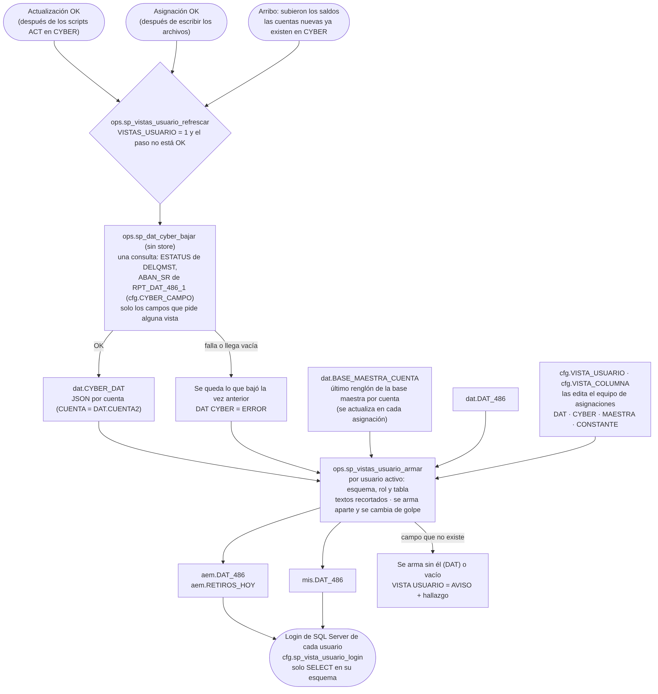

# 10 · Vistas de usuarios (AEM, MIS)



Fuente: [`mmd/10_vistas_usuario.mmd`](mmd/10_vistas_usuario.mmd) · Código: `sql/79_sp_vistas_usuario.sql`, el guardado de la base maestra por cuenta en `ops.sp_cargar_archivo` (`sql/20_sp_comunes.sql`, paso 8b)

Desde el 18/11, algunos equipos fuera de asignaciones consultan directo en SQL Server los datos que les tocan, cada uno con su login. Hoy son dos:

- **AEM:** su mapeo (`MAPEO_USUARIOS.xlsx`) y las cuentas retiradas del día. Esto sustituye al archivo `MX_G1MCT_DVBJIG_*` que no se pudo dejar en `\\192.168.50.1\Cyber_00\dev\`.
- **MIS:** usa columnas de las bases maestras que no están en el DAT. Sus columnas las agrega el equipo de asignaciones.

## Qué ve cada usuario

Cada usuario tiene **su propio esquema** (el nombre de la vista en minúsculas: `aem`, `mis`) y un rol (`rol_aem`, `rol_mis`) con `SELECT` **solo** sobre ese esquema. No ve `dat`, `ops`, `cfg` ni el esquema de otro usuario.

| Objeto | Qué trae |
|---|---|
| `<esquema>.DAT_486` | Una fila por cuenta del DAT, con las columnas de `cfg.VISTA_COLUMNA`, en su orden y con el encabezado exacto. Los textos van recortados |
| `<esquema>.RETIROS_HOY` | Solo si `VER_RETIROS = 1` (AEM): la `CUENTA` (486-folio) de las cuentas retiradas hoy en la actualización y en la asignación. Un cierre por reasignación no cuenta. Es una vista: cambia de día sola, no se trunca |

`DAT_486` es una tabla que se rearma completa en cada proceso: se arma aparte y se cambia de golpe, así que nunca la ven vacía ni a medias.

## De dónde sale cada columna

`cfg.VISTA_COLUMNA` tiene una fila por columna, con `VISTA`, `ORDEN`, `ENCABEZADO`, `ORIGEN`, `CAMPO` y `ACTIVO`:

| ORIGEN | CAMPO es | Ejemplo |
|---|---|---|
| `DAT` | Columna de `dat.DAT_486` | `CUENTA` ← `CUENTA2`; `ETIQUETA03` ← `TIPO` |
| `CYBER` | Un campo de `cfg.CYBER_CAMPO`: columna de `DELQMST` (d), `UDA1` (u) o la tabla de abandono (r: `CYBER_TABLA_ABANDONO`, de fábrica `RPT_DAT_486_1`) | `ESTATUS_CYBER` ← `ESTATUS` (`d.DMACRC2`); `ABANDONO_SR` ← `ABAN_SR` (`r.ABAN_SR`) |
| `MAESTRA` | Encabezado de la base maestra, tal como lo manda el banco | Cualquier columna de la base de TDC, Consumo o Hipotecario |
| `CONSTANTE` | Valor fijo (si es un número, va como número) | `GRUPO` ← `1` |

- **CYBER:** desde el 19/11 se lee directo de las tablas, **sin ejecutar ningún store**: ESTATUS de `DELQMST` (la misma tabla donde se validan los saldos) y ABAN_SR de `RPT_DAT_486_1`, tal como la dejó la última corrida de `PROC_DAT_486` en CYBER (decisión del 19/11). Es una sola consulta y solo trae los campos que pide alguna vista activa. Los campos disponibles están en `cfg.CYBER_CAMPO` y los mantiene sistemas.
- **MAESTRA:** cada asignación guarda el último renglón de la base maestra de cada cuenta en `dat.BASE_MAESTRA_CUENTA`. La llave es `cfg.ARCHIVO.LLAVE_DAT`: `RIESGO` en TDC y `DES_PROD` en Consumo e Hipotecario. A cada cuenta del DAT le toca la base de su `SEGMENTO2`. Si la corrida se revierte, regresa el renglón anterior.

**Agregar o cambiar una columna** (equipo de asignaciones):

```sql
USE [BNABAJ_486];
EXEC cfg.sp_vista_columna_alta 'MIS', N'LIMITE_CREDITO', 'MAESTRA', N'LIMITE DE CREDITO';     -- encabezado de la base maestra
EXEC cfg.sp_vista_columna_alta 'AEM', N'ETIQUETA05', 'DAT', N'ETIQUETA5', @orden = 175;
EXEC cfg.sp_vista_columna_alta 'AEM', N'ETIQUETA05', 'DAT', N'ETIQUETA5', @activo = 0;      -- quitarla
UPDATE cfg.VISTA_USUARIO SET ACTIVO = 1 WHERE CLIENTE = '486' AND VISTA = 'MIS';             -- activar un usuario
EXEC ops.sp_vistas_usuario_armar;                                                              -- aplicarlo ya (si no, en la siguiente actualización)
SELECT * FROM cfg.VISTA_COLUMNA WHERE CLIENTE = '486' AND VISTA = 'MIS' ORDER BY ORDEN;
```

`cfg.sp_vista_columna_alta` revisa que la columna exista en el DAT y avisa si la última base maestra no trae ese encabezado. Para quitar una columna se usa `ACTIVO = 0`: si se borra, la semilla vuelve a poner las de fábrica (las de AEM).

## Cuándo se actualiza

| Momento | Paso en la bitácora |
|---|---|
| Al terminar OK la **actualización**, después de los scripts de saldos y PVS en CYBER | `VISTAS USUARIO` |
| Al terminar OK la **asignación**, después de escribir los archivos | `VISTAS USUARIO` |
| Cuando el arribo detecta que **subieron los saldos**: las cuentas nuevas ya existen en CYBER y salen con ESTATUS y ABAN_SR | `VISTAS USUARIO SALDOS` |

Va fuera del `TRY` de la corrida: si falla, la corrida no cambia de estatus.

- **Si CYBER falla** (el store, el servidor vinculado o la tabla llega vacía), la tabla se arma igual con los datos de CYBER de la vez anterior. Queda `DAT CYBER = ERROR` y un hallazgo.
- **Si el equipo pidió un campo que no existe,** la tabla se arma sin esa columna (DAT) o con la columna vacía (CYBER, MAESTRA). Queda `VISTA USUARIO = AVISO` y un hallazgo.

A mano, con el número de corrida: `EXEC ops.sp_vistas_usuario_refrescar <id>, @forzar = 1;`

## Crear el login de un usuario

En el servidor, con un usuario que pueda crear logins. La contraseña no se guarda en ningún lado:

```sql
USE [BNABAJ_486];
EXEC cfg.sp_vista_usuario_login 'AEM', 'aem_banbaj', N'<contraseña>';   -- crea el login, el usuario y lo mete a rol_aem
```

Si el login ya existe, solo cambia la contraseña. Para dar de baja a un usuario: `ACTIVO = 0` en `cfg.VISTA_USUARIO` (se borran sus objetos en la siguiente actualización) y `DROP LOGIN`.

**Bitácora:** `DAT CYBER` (cuántas cuentas bajaron), `VISTA USUARIO` (una por usuario, con sus avisos), `VISTAS USUARIO` o `VISTAS USUARIO SALDOS`.

**Parámetros:** `VISTAS_USUARIO` (1 de fábrica); `CYBER_TABLA_ABANDONO` y `CYBER_LLAVE_ABANDONO` (tabla de CYBER de ABAN_SR / ABAN_CR y su columna con la cuenta; de fábrica `RCVRY.RPT_DAT_486_1` y `CUENTA`). Campos de CYBER: `cfg.CYBER_CAMPO`.

**Para tomar ABAN_SR de otra tabla** (si CYBER deja de llenar `RPT_DAT_486_1`): no hay que cambiar código.

```sql
USE [BNABAJ_486];
UPDATE cfg.PARAMETRO SET VALOR = 'RCVRY.OTRA_TABLA' WHERE CLIENTE = '486' AND CLAVE = 'CYBER_TABLA_ABANDONO';   -- tabla (esquema.tabla)
UPDATE cfg.PARAMETRO SET VALOR = 'CUENTA'           WHERE CLIENTE = '486' AND CLAVE = 'CYBER_LLAVE_ABANDONO';   -- su columna con la cuenta 486-folio
UPDATE cfg.CYBER_CAMPO SET EXPRESION = 'r.ABAN_SR'  WHERE CAMPO = 'ABAN_SR';                                    -- solo si la columna se llama distinto
EXEC ops.sp_dat_cyber_bajar @id_corrida = <última corrida OK>, @solo_mostrar = 1;                               -- ver la consulta que se manda a Oracle
```

**Permisos en Oracle** del usuario de `CYBER_ORACLE`: `SELECT` en `RCVRY.DELQMST`, `RCVRY.RPT_DAT_486_1` y, si algún campo la usa, `RCVRY.UDA1`. Ya no necesita `EXECUTE` en `PROC_DAT_486`.

**Errores:** 50830-50839.

**Para cambiar:** la bajada, en `ops.sp_dat_cyber_bajar`; cómo se arma cada columna, en `ops.sp_vistas_usuario_armar`; las columnas de fábrica de AEM, en `VISTAS` de `tools/generar_sql_486.py`. Pruebas: `VISTAS: …` en `tests/pruebas.sql`.
