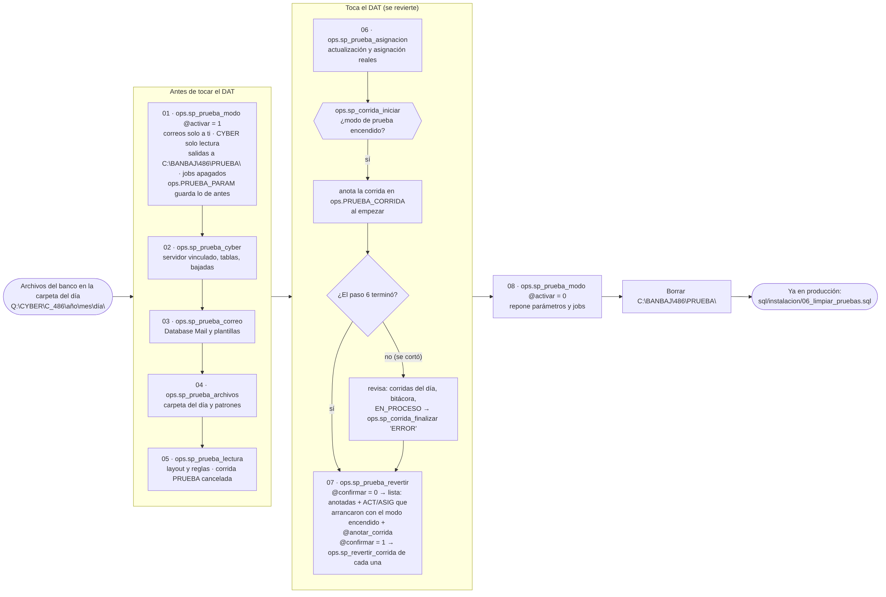

# 11 · Pruebas de entorno



Fuente: [`mmd/11_pruebas_entorno.mmd`](mmd/11_pruebas_entorno.mmd) · Código: `sql/85_sp_pruebas_entorno.sql`, el anotado de corridas en `ops.sp_corrida_iniciar` (`sql/20_sp_comunes.sql`) · Scripts: `pruebas_entorno/01` a `08` · Guía en Word: `pruebas_entorno/Guia de pruebas de entorno Banbaj 486.docx`

Sirven para probar en el servidor real antes de prender el job. Usan los archivos reales del banco, sin escribir en CYBER ni mandar correos a nadie más que a quien prueba.

| Paso | Script | Store | Qué deja |
|---|---|---|---|
| 1 | `01_modo_prueba_encender.sql` | `ops.sp_prueba_modo @activar = 1` | `ops.PRUEBA_PARAM` con los valores de antes; correos redirigidos (`CORREO_PRUEBA_PARA`), `CYBER_SOLO_LECTURA = 1`, salidas en la carpeta de prueba, jobs apagados |
| 2 | `02_bajada_cyber.sql` | `ops.sp_prueba_cyber` | Solo tablas de paso |
| 3 | `03_correos.sql` | `ops.sp_prueba_correo` | Un correo a quien prueba |
| 4 | `04_deteccion_archivos.sql` | `ops.sp_prueba_archivos` | Nada |
| 5 | `05_lectura_archivos.sql` | `ops.sp_prueba_lectura` | Una corrida `PRUEBA` cancelada |
| 6 | `06_asignacion_prueba.sql` | `ops.sp_prueba_asignacion` | Corridas ACT y ASIG reales sobre el DAT |
| 7 | `07_revertir_prueba.sql` | `ops.sp_prueba_revertir` | El DAT como antes del paso 6 |
| 8 | `08_modo_prueba_apagar.sql` | `ops.sp_prueba_modo @activar = 0` | Parámetros y jobs como antes |

## Validación: que el paso 7 encuentre todas las corridas del paso 6

Aunque el paso 6 se corte a la mitad, el paso 7 encuentra sus corridas. Hay dos candados:

1. **Al empezar:** `ops.sp_corrida_iniciar` anota la actualización o la asignación en `ops.PRUEBA_CORRIDA` en cuanto arranca, si el modo de prueba está encendido. Aunque el script se corte, la corrida ya está anotada.
2. **Al revertir:** `ops.sp_prueba_revertir` lista también las actualizaciones y asignaciones que arrancaron después de encender el modo de prueba (fecha de `ops.PRUEBA_PARAM`) aunque no estén anotadas. Con `@anotar_corrida = <id>` se agrega a mano una que haya quedado fuera (por ejemplo, si ya se apagó el modo de prueba). La columna `ORIGEN` dice por qué entra cada una.

Si una corrida quedó `EN_PROCESO` (se cortó a la mitad), el paso 7 no revierte nada hasta que se cierre:

```sql
EXEC ops.sp_corrida_finalizar <corrida>, 'ERROR', N'Se cortó en la prueba de entorno';
EXEC ops.sp_prueba_revertir @confirmar = 0;                 -- revisa la lista
EXEC ops.sp_prueba_revertir @confirmar = 1;
```

Prueba: `tests/pruebas.sql`, "PRUEBA ENTORNO: con el modo de prueba encendido la corrida queda anotada al iniciar; con el modo apagado no".

## Qué tocar para cambiarlo

- Qué cambia el modo de prueba: `ops.sp_prueba_modo` (`sql/85`).
- Qué cuenta como corrida de la prueba: el bloque del final de `ops.sp_corrida_iniciar` (`sql/20`) y la consulta del principio de `ops.sp_prueba_revertir` (`sql/85`).
- Ya en producción, `sql/instalacion/06_limpiar_pruebas.sql` borra todo esto; el anotado de `ops.sp_corrida_iniciar` deja de hacer algo solo porque las tablas ya no existen.
